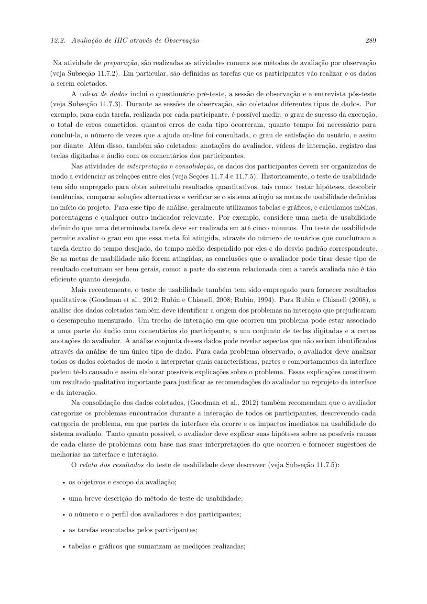

# Relato da avaliação de alta fidelidade - Alexandre Vilar

## Tabela de contribuição

**Tabela 1 - Contribuições nesta versão do artefato**

| Integrante | Contribuição | Atividade | Gravação |
| --- | --- | --- | --- |
| Alexandre Vilar Valadares Fonsêca | Estruturação do relato e do plano de consolidação | [Material individual](index.md) | — |

Fonte: minha elaboração (2026).

## Histórico de versões

**Tabela 2 - Histórico de versões**

| Data | Versão | Descrição | Autor | Revisor |
| --- | --- | --- | --- | --- |
| 11/11/2026 | 1.0 | Organização inicial da avaliação de alta fidelidade | Alexandre Vilar Valadares Fonsêca, com apoio do ChatGPT | Revisão humana pendente |
| 12/11/2026 | 1.1 | Reescrevi os textos em primeira pessoa e organizei minha verificação individual | Alexandre Vilar Valadares Fonsêca, com apoio do ChatGPT | Revisão humana pendente |

Fonte: registro desta versão (2026).

## 1. Situação do relato {#situacao}

Ainda estou preparando o relato da alta fidelidade. Vou preencher as tabelas com os dados das sessões, mantendo separados os resultados da entrevista do papel.

- Gravação do piloto de alta fidelidade: pendente.
- Gravações das sessões definitivas: pendentes; publicar apenas se autorizadas.
- Vídeo da apresentação da Entrega 7: pendente.
- [Protótipo e versão a conferir](index.md#prototipo).
- [Roteiro e registros da sessão](roteiro.md).

## 2. Estrutura do relatório dos resultados {#estrutura}

Vou organizar meu relato segundo Barbosa et al. (2021, seção 12.2.1, p. 289-290), adaptando a estrutura originalmente solicitada para o papel ao método de teste de usabilidade. Na Figura 1, apresento o trecho que usei como referência.

**Figura 1 - Medições, interpretação e estrutura do relato de usabilidade**

Fonte: Barbosa et al. (2021), p. 289. Trecho do livro que usei como referência; clique para ampliar.

**Tabela 3 - Estrutura e conteúdo a apresentar**

| Seção | Conteúdo |
| --- | --- |
| Objetivos e escopo | Q1-Q5, fluxo de vistoria e limites da simulação |
| Método | Teste de usabilidade, pensar em voz alta, pré e pós-teste; versão do Figma e procedimento efetivamente usados |
| Participantes e avaliadores | Quantidade real, perfil agregado, códigos, recrutamento, funções e exposição prévia |
| Tarefas | T1-T3, ordem, diferenças em relação ao plano e critérios de conclusão |
| Dados consolidados | Tempos, desfechos, erros, ajuda e opiniões; tabelas e gráficos quando úteis |
| Interpretação | Relação dos dados com os objetivos e com o problema de disponibilidade do papel |
| Problemas encontrados | Local, descrição, justificativa, fatores de usabilidade afetados, evidência e sugestão |
| Redesign e pendências | Correções propostas, implementadas e não resolvidas, prioridade e justificativa |
| Limitações | Amostra, recrutamento, aprendizagem, intervenções, equipamento e limitações do protótipo |
| Referências e anexos | Fontes, instrumentos e evidências autorizadas; sem publicação de termos assinados ou dados pessoais |

Fonte: Barbosa et al. (2021, p. 289-290), com adaptações ao estudo (2026).

## 3. Consolidação dos dados {#consolidacao}

Vou preencher a Tabela 4 após as sessões definitivas. Calcularei o tempo pela diferença entre o início e o fim e registrarei as falhas ou interrupções. Vou apresentar as contagens junto com a descrição dos casos.

**Tabela 4 - Síntese das sessões definitivas**

| Participante | Tarefa | Tempo | Desfecho | Dados finais corretos? | Ajuda | Evidência |
| --- | --- | --- | --- | --- | --- | --- |
| Sem dados coletados nesta versão | — | — | — | — | — | — |

Fonte: formulário desta avaliação; sem resultados nesta versão.

## 4. Problemas e prioridade de correção {#problemas}

Vou agrupar as ocorrências semelhantes e manter seus registros vinculados. Para minha análise, vou usar prioridade **alta** quando impede concluir ou produz confirmação incorreta; **média** quando exige ajuda, causa erro recuperável ou dificulta reconhecer a disponibilidade; **baixa** quando há incômodo sem impedimento da tarefa. Esses critérios são uma convenção operacional do projeto, não uma escala atribuída ao livro.

**Tabela 5 - Registro de problemas e reprojeto**

| ID | Tela / tarefa | Comportamento e evidência | Interpretação / fator afetado | Sugestão | Prioridade | Situação |
| --- | --- | --- | --- | --- | --- | --- |
| A preencher após a avaliação | — | — | — | — | — | Não avaliado |

Fonte: adaptação dos elementos do relato em Barbosa et al. (2021, p. 289-290).

Para cada problema que eu não resolver, vou registrar a justificativa, o risco e a próxima ação. Só vou marcar uma correção como concluída depois de conferir a alteração no protótipo e, quando necessário, reavaliá-la.

## 5. Planejamento do relato {#plano-relato}

Depois das sessões propostas para 12/11, vou organizar os registros e redigir o relato entre 12 e 13/11. Planejei a conferência e a revisão entre 13 e 14/11; ainda preciso confirmar quem fará a revisão.

Vou conferir as evidências, separar os dados do piloto, anonimizar as sínteses e verificar as autorizações antes de integrar minha parte ao [relatório coletivo](../../relatorio.md) e preparar minha apresentação. Se eu precisar reagendar alguma atividade, vou atualizar o cronograma.

## Referências

BARBOSA, Simone Diniz Junqueira et al. **Interação Humano-Computador e Experiência do Usuário.** 1. ed. Autopublicação, 2021. Seções 7.4 (p. 126-128), 11.7 (p. 258-263), 11.8 (p. 264) e 12.2.1 (p. 288-290).

SALES, André Barros de. **Plano de Ensino de Interação Humano-Computador, 2026.2.** Universidade de Brasília, 2026. [Documento do projeto](../../../disciplina/plano-de-ensino.md).

## Uso de IA generativa

Utilizei o ChatGPT (OpenAI) como apoio para organizar os materiais, revisar a redação e adaptar o planejamento com base nos livros e nos registros do meu trabalho. Mantive as referências e diferenciei o que já realizei do que ainda está planejado. Os resultados, vídeos, autorizações e revisões dependem dos registros reais de cada atividade.
