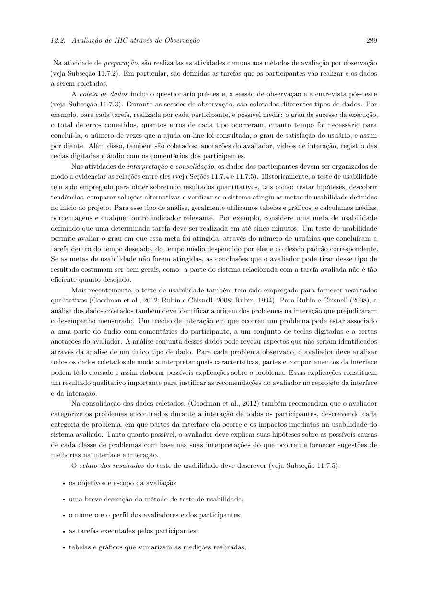

# Relato da avaliação de alta fidelidade - Alexandre Vilar

## Tabela de contribuição

**Tabela 1 - Contribuições nesta versão do artefato**

| Integrante | Contribuição | Atividade | Gravação |
| --- | --- | --- | --- |
| Alexandre Vilar Valadares Fonsêca | Análise das entrevistas, consolidação dos achados e registro das limitações | [Material individual](index.md) | [Entrevistas e teste técnico](#videos) |

Fonte: minha elaboração (2026).

## Histórico de versões

**Tabela 2 - Histórico de versões**

| Data | Versão | Descrição | Autor | Revisor |
| --- | --- | --- | --- | --- |
| 11/11/2026 | 1.0 | Organização inicial da avaliação de alta fidelidade | Alexandre Vilar Valadares Fonsêca, com apoio do ChatGPT | Revisão humana pendente |
| 12/11/2026 | 1.1 | Reescrevi os textos em primeira pessoa e organizei minha verificação individual | Alexandre Vilar Valadares Fonsêca, com apoio do ChatGPT | Revisão humana pendente |
| 15/11/2026 | 1.2 | Analisei as duas entrevistas e o teste técnico e publiquei os resultados com evidências | Alexandre Vilar Valadares Fonsêca, com apoio do ChatGPT | Revisão humana pendente |

Fonte: registro desta versão (2026).

## 1. Situação do relato {#situacao}

Reuni neste relato os resultados das duas entrevistas de uso do meu protótipo de alta fidelidade para o **agendamento de Vistoria de Transferência Veicular**. Também vinculei o vídeo apresentado como teste-piloto, que registra um ensaio técnico de áudio e imagem. Mantive esse ensaio fora da consolidação das entrevistas.

Nas duas entrevistas, as participantes verbalizaram a conclusão do agendamento e avaliaram positivamente a navegação. Encontrei indícios de que a disponibilidade de datas e horários foi compreendida. Analisei esses achados considerando a orientação sobre as dicas do Figma, as tarefas efetivamente realizadas e a exposição prévia de uma participante ao ensaio técnico.

### Vídeos da avaliação {#videos}

Na Tabela 3, identifiquei os três registros. Usei **P01** e **P02** para apresentar a análise sem repetir os nomes das participantes. A numeração acompanha os títulos dos vídeos, não a ordem em que recebi os links. Os três vídeos estavam identificados como **não listados** no YouTube na conferência de 15/11/2026.

**Tabela 3 - Gravações analisadas**

| Registro | Título e link | Duração do vídeo | Uso na análise |
| --- | --- | --- | --- |
| P01 | [Protótipo Figma 1](https://www.youtube.com/watch?v=wnJlDlcPovM) | 3min29s | Entrevista definitiva; participante declara ser habilitada há mais de dez anos. |
| P02 | [Protótipo Figma 2](https://www.youtube.com/watch?v=ep_X7X6ZNqU) | 2min59s | Entrevista definitiva; participante declara ter 30 anos e ser habilitada. |
| Ensaio técnico com P02 | [Teste piloto figma](https://www.youtube.com/watch?v=3RgfdKVybGU) | 31s | Verificação de áudio, imagem e interação livre; não contei como terceira participante nem como tarefa definitiva. |

Fonte: meus vídeos publicados no YouTube e conferidos em 15/11/2026.

O vídeo de apresentação específica da Entrega 7 ainda precisa ser vinculado. Os links acima são das entrevistas e do ensaio técnico.

## 2. Objetivos, método e contexto {#estrutura}

Organizei o relato conforme Barbosa et al. (2021, seção 11.7.5, p. 263, e seção 12.2.1, p. 288-290). Na Figura 1, apresento o trecho usado como referência para a análise e o relato do teste de usabilidade.

**Figura 1 - Medições, interpretação e estrutura do relato de usabilidade**

Fonte: Barbosa et al. (2021), p. 289. Trecho do livro que usei como referência.

Meu objetivo foi observar se as participantes encontravam o serviço, escolhiam local, data e horário, compreendiam a disponibilidade e reconheciam a confirmação. Usei o [protótipo no Figma](prototipo.md), com dados simulados, observação da interação e verbalização dos pensamentos. Conduzi as duas entrevistas e pedi que as participantes comentassem o que entendiam durante a navegação.

Para consolidar as falas e localizar as evidências, utilizei as transcrições automáticas disponibilizadas pelo YouTube. Essas transcrições podem conter erros. Tratei os intervalos abaixo como referências de trechos e verbalizações; não fiz contagem exaustiva dos cliques nem uma medição independente de todas as telas e erros. A filmagem externa e a legibilidade limitada do monitor também restringem a conferência detalhada dos campos do resumo final.

### Participantes, datas e consentimento {#participantes}

Analisei **duas participantes distintas**. P01 declarou experiência de mais de dez anos como habilitada; P02 declarou ter 30 anos e ser habilitada. Não encontrei no registro analisado uma caracterização completa de experiência com o portal ou de recrutamento. Também preciso completar o local da aplicação, eventual apoio e os horários exatos de início e fim.

Na sessão de P01, a data **13/11/2026** foi declarada no [trecho de 3:14](https://www.youtube.com/watch?v=wnJlDlcPovM&t=194s). Não atribuí essa mesma data automaticamente à sessão de P02 ou ao ensaio técnico. A data de publicação dos vídeos, 15/11/2026, não foi usada como data da aplicação.

Em P01, anunciei que o termo de consentimento já havia sido lido e assinado ([0:47](https://www.youtube.com/watch?v=wnJlDlcPovM&t=47s)). Em P02, apresentei o termo e anunciei a assinatura naquele momento ([0:33](https://www.youtube.com/watch?v=ep_X7X6ZNqU&t=33s)). Ainda preciso conferir os documentos originais, o prazo de armazenamento e o alcance da autorização de divulgação; não publiquei cópias assinadas neste relato.

### Tarefas executadas e diferenças do planejamento {#tarefas-reais}

Os [cenários planejados T1–T3](roteiro.md#tarefas) especificavam combinações de datas e horários. Nas entrevistas, apresentei um cenário mais aberto: uma pessoa do Lago Sul precisava agendar uma vistoria e poderia escolher entre as vagas disponíveis. Cada vídeo definitivo documenta **um percurso de agendamento**. Não considerei esses registros como execução completa da bateria T1–T3 por cada participante.

P01 escolheu **18/11 às 11h00**, em vez das 10h00 previstas em T2. P02 procurou o dia **24/11**, percebeu que não havia vaga e passou para **23/11 às 15h00**; esse percurso não equivale ao cenário T3 original, que partia do horário de 11h00. As seleções são as verbalizadas nos trechos; não completei campos ilegíveis do resumo por suposição.

Também expliquei às duas participantes que clicar na área branca poderia revelar as áreas clicáveis em azul: [P01, 0:56–1:12](https://www.youtube.com/watch?v=wnJlDlcPovM&t=56s) e [P02, 1:21–1:35](https://www.youtube.com/watch?v=ep_X7X6ZNqU&t=81s). Registrei essa orientação como apoio prévio de navegação, mesmo sem afirmar que cada participante acionou a dica. Por isso, não classifiquei as conclusões como desempenho comprovadamente independente de ajuda.

## 3. Consolidação dos dados {#consolidacao}

Na Tabela 4, reuni os percursos e os desfechos verbalizados. A identificação de uma opção sem vaga foi tratada como situação de disponibilidade e recuperação, não como erro da participante.

**Tabela 4 - Síntese das entrevistas definitivas**

| Registro | Percurso e seleção verbalizada | Disponibilidade | Desfecho e opinião | Apoio e evidência |
| --- | --- | --- | --- | --- |
| P01 | Agendamento presencial, atendimento presencial, novo agendamento, vistoria; escolhe 18/11 e 11h00 no contexto Lago Sul | Interpreta datas azuis como disponíveis e identifica 10h00 e 11h00 como opções | Indica o agendamento ao final e descreve o uso como fácil | Orientação prévia sobre as dicas do Figma; [1:13–3:08](https://www.youtube.com/watch?v=wnJlDlcPovM&t=73s) |
| P02 | Agendamento presencial, vistoria e Lago Sul; procura 24/11 e muda para 23/11 às 15h00 | Verbaliza que 24/11 está sem vaga e escolhe alternativa | Diz que o agendamento foi confirmado; considera a plataforma intuitiva e informa não ter mudanças a sugerir naquele momento | Orientação prévia sobre as dicas do Figma; [1:49–2:59](https://www.youtube.com/watch?v=ep_X7X6ZNqU&t=109s) |

Fonte: minha análise das transcrições das entrevistas, com apoio do ChatGPT (2026).

Nas **duas entrevistas**, houve indicação verbal de conclusão e opinião positiva. **Uma participante** verbalizou a mudança de uma data sem vaga para outra disponível. Essas contagens descrevem os registros disponíveis; não as transformei em taxa de sucesso independente ou em comprovação de ausência de problemas.

### Intervalos de referência {#tempos}

Na Tabela 5, usei a diferença entre a primeira ação verbalizada e o reconhecimento verbal do resultado. Esses intervalos incluem fala e interação, não substituem uma cronometragem controlada da tarefa e não demonstram que uma participante foi mais eficiente que a outra.

**Tabela 5 - Intervalos entre verbalizações nos vídeos**

| Registro | Primeira ação verbalizada | Reconhecimento do resultado | Intervalo aproximado |
| --- | --- | --- | --- |
| P01 | 1:13 | 3:00 | 1min47s |
| P02 | 1:49 | 2:35 | 46s |

Fonte: marcas de tempo da transcrição do YouTube (2026). Não calculei média de eficiência, pois os percursos, as escolhas e a verbalização diferiram. Não atribuí zero erros: não disponho de uma contagem exaustiva e validada de erros e cliques.

### Respostas às perguntas do DECIDE {#respostas-decide}

Na Tabela 6, relacionei os achados com as perguntas do meu planejamento.

**Tabela 6 - Questões da avaliação e evidências**

| Questão | Resultado e interpretação | Evidência |
| --- | --- | --- |
| Q1 — Encontrar o caminho e o serviço | As duas participantes verbalizam o acesso ao agendamento e a escolha da vistoria. É um indício de compreensão dos rótulos, considerando a orientação sobre as dicas. | [P01, 1:13–1:53](https://www.youtube.com/watch?v=wnJlDlcPovM&t=73s); [P02, 1:49–1:55](https://www.youtube.com/watch?v=ep_X7X6ZNqU&t=109s) |
| Q2 — Escolher local, data e horário | Os registros mostram escolhas verbalizadas, mas os cenários foram abertos e diferiram de T1–T3. Não confirmei a correção de todos os campos da tela final apenas pela transcrição. | [P01, 2:01–2:52](https://www.youtube.com/watch?v=wnJlDlcPovM&t=121s); [P02, 2:05–2:33](https://www.youtube.com/watch?v=ep_X7X6ZNqU&t=125s) |
| Q3 — Distinguir disponibilidade | P01 associa datas azuis às vagas e identifica horários. P02 reconhece que 24/11 não tem vaga e procura outra data. O comportamento é favorável à melhoria de disponibilidade proposta no papel. | [P01, 2:09–2:30](https://www.youtube.com/watch?v=wnJlDlcPovM&t=129s); [P02, 2:05–2:26](https://www.youtube.com/watch?v=ep_X7X6ZNqU&t=125s) |
| Q4 — Reconhecer a confirmação | P01 indica seu agendamento ao final; P02 afirma explicitamente que foi confirmado. Há evidência verbal de reconhecimento do resultado nos dois casos. | [P01, 2:52–3:08](https://www.youtube.com/watch?v=wnJlDlcPovM&t=172s); [P02, 2:33–2:41](https://www.youtube.com/watch?v=ep_X7X6ZNqU&t=153s) |
| Q5 — Obstáculos e melhorias | As opiniões registradas são positivas. P02 não sugere mudança ao ser perguntada. Isso não demonstra que a interface esteja livre de problemas nem que todas as perguntas pós-teste tenham sido aplicadas. | [P01, 3:00–3:08](https://www.youtube.com/watch?v=wnJlDlcPovM&t=180s); [P02, 2:35–2:59](https://www.youtube.com/watch?v=ep_X7X6ZNqU&t=155s) |

Fonte: minha interpretação das entrevistas, orientada por Barbosa et al. (2021, p. 262-264 e 289-290).

## 4. Achados, limitações e prioridades {#problemas}

Não identifiquei nas falas analisadas um impedimento de interface relatado como bloqueador da conclusão. Diferenciei os indícios positivos das limitações de avaliação e das recomendações que ainda precisam ser testadas. Não registrei uma recomendação minha como se tivesse sido solicitada pelas participantes.

**Tabela 7 - Achados e encaminhamentos**

| ID | Tipo e local | Evidência e impacto na interpretação | Encaminhamento | Prioridade / situação |
| --- | --- | --- | --- | --- |
| A01 | Indício positivo: calendário e horários | P01 reconhece vagas e P02 troca uma data sem vaga. A disponibilidade parece compreensível nos casos observados. | Manter a sinalização e conferir também rótulos textuais; avaliar a compreensão sem dicas. | Manter e reavaliar; não classifiquei como defeito observado. |
| A02 | Indício positivo: confirmação | As duas participantes verbalizam o resultado. | Preservar o resumo e a mensagem final; conferir a leitura dos dados em gravação direta da tela. | Manter e reavaliar. |
| L01 | Limitação: orientação sobre dicas do Figma | Expliquei como revelar áreas clicáveis, o que pode facilitar a descoberta de controles. | Em uma nova rodada, avaliar sem ensinar a solução; registrar separadamente qualquer ajuda. | Alta para a próxima avaliação; não implementado como nova rodada. |
| L02 | Limitação: exposição prévia de P02 | O ensaio técnico usa a mesma pessoa da segunda entrevista e solicita interação livre. Pode haver aprendizagem. | Registrar a exposição; preferir outra pessoa para um piloto completo ou novos participantes sem contato prévio. | Alta para uma nova rodada; não descarta automaticamente a opinião registrada. |
| L03 | Limitação: cobertura das tarefas | Os vídeos documentam uma escolha livre por pessoa, não toda a bateria T1–T3 e sua ordem planejada. | Reaplicar os cenários se for necessário validar especificamente todas as combinações e os critérios originais. | Alta; cobertura original incompleta. |
| L04 | Limitação: registro e medidas | Transcrição automática, monitor filmado e ausência de contagem validada de erros e cliques. | Conferir gravações originais; usar captura direta no OBS, marcação de início/fim e ficha de observação. | Média; contagem detalhada pendente. |
| R01 | Recomendação de acessibilidade: indicação de vagas | P01 usa a cor azul como pista. Não realizei teste de percepção de cores. | Conferir se textos e estados distinguem vagas sem depender só da cor; testar essa compreensão. | Média; recomendação de conferência, não falha comprovada. |

Fonte: minha análise das evidências e das limitações do procedimento, com base em Barbosa et al. (2021, p. 260, 263-264 e 289-290).

As prioridades acima são critérios operacionais para organizar a próxima rodada. Não atribuí uma escala de gravidade do livro a problemas que não foram demonstrados. A pequena amostra, a exposição prévia e o apoio do Figma limitam a generalização dos resultados. As opiniões positivas não comprovam melhoria de eficiência em relação ao papel, pois não houve comparação controlada entre versões.

## 5. Consolidação e planejamento do reprojeto {#plano-relato}

Concluí a primeira consolidação documental em **15/11/2026**, com base nos três links recebidos. As entrevistas forneceram indícios favoráveis à descoberta do serviço, à leitura da disponibilidade e ao reconhecimento da confirmação. Ainda preciso completar a logística e conferir os registros originais e as autorizações.

Na Tabela 8, organizei os próximos encaminhamentos. Não considerei as verificações abaixo como alterações já executadas no Figma.

**Tabela 8 - Próximos passos após a análise**

| Atividade | Responsável | Momento previsto | Situação |
| --- | --- | --- | --- |
| Conferir transcrição, campos finais e dados de aplicação com os registros originais | Eu | Antes da versão final do relato | Pendente |
| Completar local, datas faltantes, recrutamento e autorizações | Eu | Antes da entrega final | Pendente |
| Conferir sinalização textual de vagas e versão exata do protótipo | Eu | Antes de uma nova avaliação | Pendente |
| Preparar piloto completo e aplicar cenários padronizados, se houver nova rodada | Eu; participantes a confirmar | A agendar | Recomendado |
| Revisar o relato e atualizar evidências da checklist | Eu e revisor a confirmar | Antes da consolidação final | Revisão humana pendente |
| Integrar minha síntese ao relatório coletivo | Eu | 15/11/2026 | Síntese e links adicionados nesta versão |

Fonte: meu planejamento após a análise (2026).

## 6. Registro do teste técnico apresentado como piloto {#piloto-realizado}

No [vídeo de 31 segundos](https://www.youtube.com/watch?v=3RgfdKVybGU), apresentei a atividade como teste de áudio e imagem e pedi interação livre com o sistema ([0:03](https://www.youtube.com/watch?v=3RgfdKVybGU&t=3s)). Depois, solicitei fala para conferir o áudio ([0:18](https://www.youtube.com/watch?v=3RgfdKVybGU&t=18s)). A pessoa apresentada é a mesma de P02; não contei uma terceira participante.

Esse registro evidencia um **ensaio técnico**, mas não comprova sozinho o piloto completo descrito em Barbosa et al. (2021, p. 260): executar o procedimento, verificar instruções e tarefas, fazer breve análise e corrigir o que for necessário. O vídeo não documenta todos esses passos, nem sua data e ordem em relação às duas sessões. Também difere do meu plano de usar uma pessoa distinta. Mantive essas limitações explícitas.

Não incorporei o ensaio às contagens ou aos intervalos das entrevistas definitivas. O reaproveitamento da mesma participante foi registrado como possível efeito de aprendizagem, sem tratar os dados do ensaio como resultado da avaliação principal.

## Referências

BARBOSA, Simone Diniz Junqueira et al. **Interação Humano-Computador e Experiência do Usuário.** 1. ed. Autopublicação, 2021. Seções 7.4 (p. 126-128), 11.7 (p. 258-263), 11.8 (p. 264) e 12.2.1 (p. 288-290).

SALES, André Barros de. **Plano de Ensino de Interação Humano-Computador, 2026.2.** Universidade de Brasília, 2026. [Documento do projeto](../../../disciplina/plano-de-ensino.md).

## Uso de IA generativa

Utilizei o ChatGPT (OpenAI) como apoio para organizar os materiais, revisar a redação e adaptar o planejamento com base nos livros e nos registros do meu trabalho. Mantive as referências e diferenciei o que já realizei do que ainda está planejado. Utilizei as falas registradas nas transcrições automáticas dos vídeos e mantive como pendentes as informações que não consegui confirmar. As recomendações são distintas das falas das participantes.
