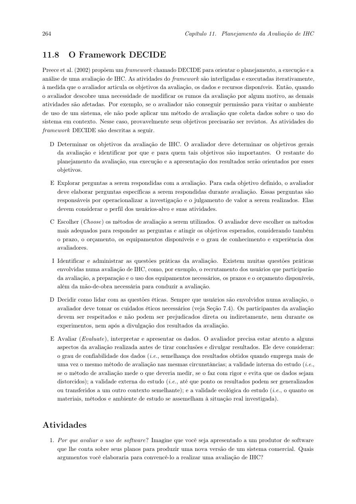
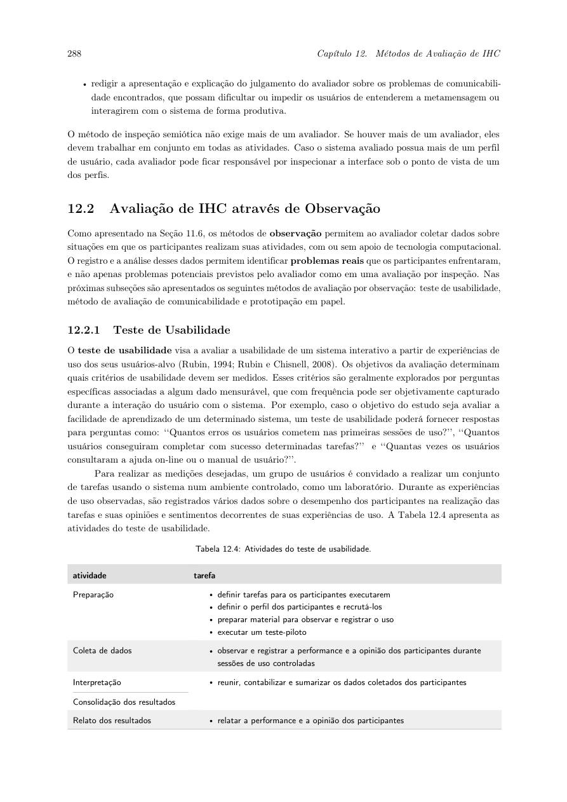
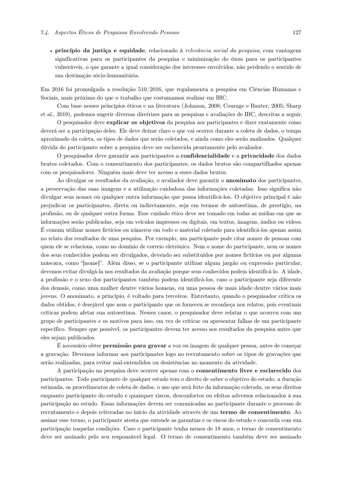
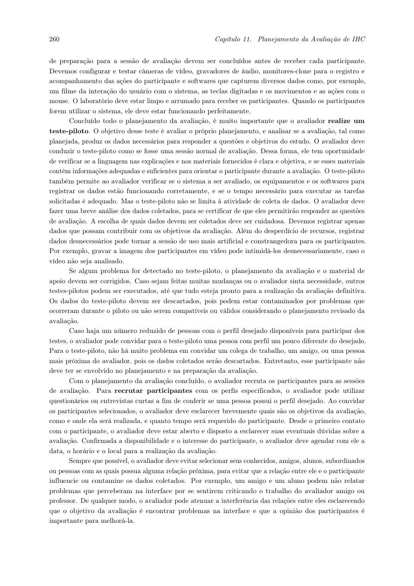
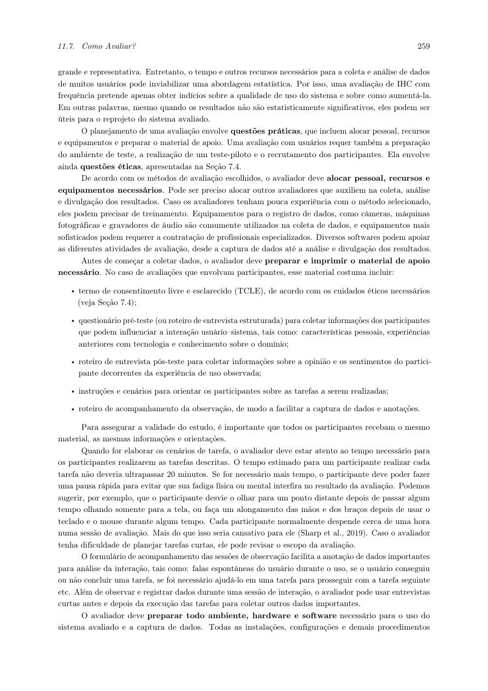

# Planejamento DECIDE da avaliação de alta fidelidade – João Vitor

## Tabela de contribuição

**Tabela 1 – Minha contribuição neste artefato**

| Integrante | Contribuição | Atividade | Gravação |
| --- | --- | --- | --- |
| João Vitor | Adaptação do DECIDE ao agendamento e gerenciamento de biometria | [Minha entrega](index.md) | [Gravações da avaliação](relato.md#gravacoes) |

Fonte: elaboração do autor (2026).

## Histórico de versões

**Tabela 2 – Histórico de versões**

| Data | Versão | Descrição | Autor | Revisor |
| --- | --- | --- | --- | --- |
| 14/11/2026 | 1.0 | Planejamento, referências, logística e cronograma vinculados à Entrega 6 | João Vitor | Gabriel Robson |
| 15/11/2026 | 1.1 | Vinculação das gravações e atualização da situação da análise preliminar | João Vitor | Gabriel Robson |
| 15/11/2026 | 1.2 | Atualização das datas de aplicação e da situação do relato com o complemento de P03 | João Vitor | Gabriel Robson |

Fonte: registro desta versão (2026).

!!! note "Planejamento e execução registrada"
    Este documento preserva o planejamento original. Realizei as aplicações em 14/11/2026, com três registros de participantes, em vez dos dois inicialmente propostos, e um registro de piloto. O [relato](relato.md#tarefas-reais) descreve as tarefas efetivas, as orientações durante o uso e o reagendamento de P03 informado pelo avaliador.

## 1. Introdução {#introducao}

Adaptei o [planejamento da minha Entrega 6](../../../entrega-6/integrantes/joao-vitor/planejamento-alta-fidelidade.md) para avaliar o fluxo de **agendamento e gerenciamento da biometria**, mantendo T1–T4 e os dados de observação já previstos. A alta fidelidade é uma aplicação HTML/CSS/JavaScript executável no Pages e offline; a conversa do WhatsApp também é simulada dentro dela.

## 2. Framework DECIDE {#decide}

Organizei as seis atividades do DECIDE de Barbosa et al. (2021, seção 11.8, p. 264). A Figura 1 apresenta a referência bibliográfica utilizada.

**Figura 1 – As seis atividades do Framework DECIDE**

Fonte: Barbosa et al. (2021), p. 264. Trecho bibliográfico já disponibilizado na área de Alexandre Vilar, reutilizado como fundamentação teórica; não é evidência de execução da minha avaliação.

### D – Determinar os objetivos {#objetivos}

Quero identificar problemas de interação/interface e verificar se as pessoas conseguem agendar a biometria e gerenciar o atendimento pelo lembrete sem repetir desnecessariamente o processo inicial. A avaliação apoiará decisões de redesign da minha proposta acadêmica; não mede o serviço real do Detran-DF.

Os objetivos específicos são verificar descoberta do serviço; preenchimento progressivo de unidade, data, horário e contato; compreensão da revisão e da confirmação; continuidade entre portal e WhatsApp; distinção entre confirmar presença, reagendar e cancelar; e recuperação ao desistir de uma alteração.

### E – Explorar perguntas {#perguntas}

A Tabela 3 relaciona as perguntas de avaliação com evidências que serão registradas nas sessões.

**Tabela 3 – Perguntas e dados a observar**

| Código | Pergunta | Evidência a registrar |
| --- | --- | --- |
| Q1 | A pessoa encontra o agendamento e a categoria Biometria? | Percurso, desvios, hesitações, ajuda e desfecho de T1 |
| Q2 | Consegue selecionar unidade/data/horário e informar o contato? | Valores escolhidos, tentativas, validação, erros e resumo final |
| Q3 | Entende a diferença entre revisar e confirmar o agendamento? | Explicação espontânea e reconhecimento da tela de sucesso |
| Q4 | Identifica o lembrete e confirma a presença sem refazer o agendamento? | Ações e estado final de T2 |
| Q5 | Consegue reagendar e reconhecer os novos dados e a liberação da vaga anterior? | Dados antes/depois de T3, mensagem e consulta no portal |
| Q6 | Entende a confirmação de cancelamento e consegue voltar sem cancelar? | Caminho de T4, desistência, confirmação e estado final |
| Q7 | Quais obstáculos e sugestões identifica no portal e na conversa? | Erros, ajuda, comentários, conforto e respostas pós-teste |

Fonte: adaptação do autor aos objetivos da biometria (2026).

Vou considerar conclusão independente, conclusão com ajuda, não conclusão e interrupção. Dados finais corretos e reconhecimento do resultado serão conferidos separadamente. O tempo será medido, mas não estabeleci uma meta de desempenho validada. A estimativa de cinco a sete minutos por tarefa serve à organização da sessão.

### C – Escolher os métodos {#metodo}

Vou realizar **teste de usabilidade por observação**, com pensar em voz alta e entrevista breve antes/depois das tarefas. Vou registrar desempenho e opinião sem ensinar o caminho. A Figura 2 reproduz a definição e as atividades do método, conforme Barbosa et al. (2021, seção 12.2.1, p. 288–290).

**Figura 2 – Definição e atividades do teste de usabilidade**

Fonte: Barbosa et al. (2021), p. 288. Trecho bibliográfico já disponibilizado na área de Alexandre Vilar, reutilizado como fundamentação teórica; não é evidência de execução da minha avaliação.

**Autor do item de conteúdo:** João Vitor. Adaptei o método ao uso contínuo do portal e do WhatsApp simulado. Não classificarei os testes automatizados de funcionamento como avaliação com usuários.

Vou usar a mesma versão, cenários, instruções e equipamentos por participante. Pensar em voz alta, a ordem das tarefas e intervenções podem afetar o tempo e serão considerados na interpretação.

### I – Identificar questões práticas {#questoes-praticas}

A Tabela 4 apresenta uma proposta operacional; recrutamento e logística ainda precisam de confirmação.

**Tabela 4 – Logística planejada**

| Aspecto | Proposta / situação |
| --- | --- |
| Perfil | Pessoas com 18 anos ou mais que utilizem navegador e WhatsApp; registrar experiência com Detran-DF e necessidade/experiência de biometria; CNH prévia não é exigida para simular o fluxo |
| Recrutamento | Convite individual no convívio acadêmico/social, com triagem; priorizar quem não construiu ou viu o protótipo |
| Quantidade | Proposta de dois participantes definitivos e uma pessoa distinta para o piloto; ainda não confirmados |
| Justificativa | Estudo exploratório qualitativo no prazo acadêmico, para identificar problemas; não permite generalizar taxas para a população |
| Local/modalidade | Proposta presencial em ambiente silencioso e controlado; local e horários a confirmar, sem publicar endereço residencial |
| Equipamentos | Computador, navegador atualizado, mouse, teclado, bateria/energia e armazenamento; internet para Pages ou ZIP offline como alternativa previamente definida |
| Gravação | Proposta de OBS Studio para tela/áudio, condicionada ao consentimento e ao teste do equipamento no piloto |
| Materiais | [Roteiro e instrumentos](roteiro.md#instrumentos), TCLE, pré-teste, cartões T1–T4, observação e pós-teste |
| Duração | Estimativa de 35–45 minutos por pessoa, incluindo abertura e entrevista; pausas ou encerramento a pedido; limite de condução por tarefa de 20 minutos, sem tratá-lo como meta de sucesso |
| Equipe | João Vitor como moderador e responsável pela análise; observador de apoio a confirmar |
| Sem observador | Com autorização, gravar tela/áudio e complementar as anotações depois; declarar essa condição como limitação |
| Orçamento incremental | Proposta de R$ 0 com recursos já disponíveis e participação voluntária; revisar se surgir despesa |
| Contingência | Se falhar a internet, usar o ZIP com a mesma versão, caso isso tenha sido definido e conferido antes; registrar a mudança de ambiente. Falha do protótipo/equipamento implica pausa ou reagendamento |

Fonte: proposta do autor, orientada por Barbosa et al. (2021, p. 258–260).

Vou testar em computador e registrar navegador e resolução; não vou atribuir a esta avaliação conclusões sobre celular sem sessões nessa modalidade. As três datas de demonstração são calculadas a partir do dia de abertura: vou anotá-las no início de cada sessão e selecionar no cenário a primeira data oferecida, sem depender de uma data fixa já vencida.

### D – Decidir as questões éticas {#etica}

Vou explicar objetivo, duração, procedimento, riscos de desconforto, dados coletados e formas de divulgação antes de solicitar consentimento. A participação é voluntária, com possibilidade de pausa, recusa de perguntas e desistência sem penalidade.

Usarei códigos PP01 para o piloto e P01/P02 para sessões definitivas. O contato será fictício, como (61) 99999-1234; não solicitarei telefone real, senha Gov.br, CPF, imagem biométrica ou documento pessoal. Não há coleta real de biometria nem envio de mensagens.

Os termos assinados e arquivos brutos terão acesso restrito à equipe. Sínteses no Pages serão anonimizadas. A divulgação de gravação identificável exigirá autorização específica e conferência de notificações, nomes e outras informações pessoais. O prazo de armazenamento/descarte e o contato do responsável deverão ser preenchidos no TCLE antes da assinatura. A Figura 3 fundamenta esses cuidados.

**Figura 3 – Diretrizes de informação, confidencialidade e privacidade**

Fonte: Barbosa et al. (2021), p. 127. Trecho bibliográfico já disponibilizado na área de Alexandre Vilar, reutilizado como fundamentação teórica; não é evidência de execução da minha avaliação.

### E – Avaliar, interpretar e apresentar os dados {#analise}

Vou separar o piloto das sessões definitivas. Para cada tarefa, registrarei tempo, desfecho, valores escolhidos, erros, desvios, ajuda e comentários. Vou conferir o estado final e relacionar cada interpretação a uma evidência com marca de tempo.

Vou apresentar contagens e descrições dos casos, sem inferência estatística sobre a população. Vou agrupar problemas semelhantes, indicar a tarefa/tela e priorizar correções. As limitações de amostra, aprendizagem entre tarefas, intervenção e simulação serão registradas. A [estrutura do relato](relato.md#estrutura) está preparada, com resultados pendentes.

## 3. Teste-piloto {#piloto}

O piloto verificará o **procedimento da avaliação**, a clareza dos cenários, os instrumentos, as interações, a gravação, o conforto e a duração. Não é a sessão definitiva nem se confunde com uma checagem técnica de botões. Vou conduzi-lo com uma pessoa que não participou da preparação, analisar os registros e ajustar o procedimento antes das sessões. A Figura 4 apresenta a referência.

**Figura 4 – Finalidade do teste-piloto e tratamento separado de seus dados**

Fonte: Barbosa et al. (2021), p. 260. Trecho bibliográfico já disponibilizado na área de Alexandre Vilar, reutilizado como fundamentação teórica; não é evidência de execução da minha avaliação.

**Autor do item de conteúdo:** João Vitor. O vídeo apresentado como piloto foi vinculado; sua aplicação foi confirmada como 14/11/2026; a participação de pessoa externa à preparação ainda precisa de identificação, conforme o [registro analisado](relato.md#piloto). O vídeo da Entrega 6 pertence ao papel e não será apresentado como piloto desta versão.

### Separação dos resultados {#dados-piloto}

Os registros de PP01 ficarão separados de P01/P02. Não vou somar tempos, erros ou sucessos do piloto aos resultados definitivos. Se o piloto motivar alteração relevante, vou atualizar a versão e avaliar a necessidade de repetir o piloto.

## 4. Cronograma de avaliação {#cronograma}

A Tabela 5 transcreve o cronograma da minha Entrega 6. **As datas são previsões anteriores, não comprovação de execução.** As aplicações foram realizadas em 14/11/2026. Registrei essa data como execução; a caracterização do piloto e a logística detalhada ainda precisam de complemento. As datas abaixo continuam identificadas como previsões anteriores.

**Tabela 5 – Cronograma previsto na Entrega 6 e situação atual**

| Atividade | Início previsto | Fim previsto | Local previsto | Situação desta versão |
| --- | --- | --- | --- | --- |
| Construção da alta fidelidade | 05/11/2026 | 10/11/2026 | Remoto | Protótipo agora disponível; o período original não é declarado como execução |
| Teste-piloto | 12/11/2026 | 12/11/2026 | A definir | Vídeo de aplicação em 14/11/2026; caracterização do procedimento a complementar |
| Sessões com participantes | 13/11/2026 | 14/11/2026 | A definir | P01/P02/P03 aplicados em 14/11/2026; horários não registrados |
| Interpretação e consolidação | 14/11/2026 | 15/11/2026 | Remoto | Relato de P01/P02/P03 disponível, incluindo o reagendamento informado para P03 |
| Relato e publicação | 15/11/2026 | 15/11/2026 | Remoto | Estrutura preparada; resultados, revisão e apresentação pendentes |

Fonte: [cronograma da Entrega 6](../../../entrega-6/integrantes/joao-vitor/planejamento-alta-fidelidade.md#5-cronograma-previsto) e situação informada pelo autor nesta versão (2026).

A aplicação em 14/11/2026 foi confirmada; horários de início/fim, local e perfil agregado serão incluídos quando detalhados. O prazo coletivo de entrega é 15/11/2026, às 23h59, conforme o [relatório coletivo](../../relatorio.md#2-prazos); o prazo não substitui a necessidade de registrar o que foi realizado.

## 5. Materiais e tarefas {#materiais}

Preparei TCLE, triagem, instruções, cenários T1–T4, folha do observador e pós-teste no [roteiro](roteiro.md). A Figura 5 mostra a orientação bibliográfica sobre a preparação do material e os limites de condução.

**Figura 5 – Preparação dos instrumentos e condução das tarefas**

Fonte: Barbosa et al. (2021), p. 259. Trecho bibliográfico já disponibilizado na área de Alexandre Vilar, reutilizado como fundamentação teórica; não é evidência de execução da minha avaliação.

## Referências

BARBOSA, Simone Diniz Junqueira et al. **Interação Humano-Computador e Experiência do Usuário.** 1. ed. Autopublicação, 2021. Seções 7.4 (p. 126–128), 11.7 (p. 258–263), 11.8 (p. 264) e 12.2.1 (p. 288–290).

SALES, André Barros de. **Plano de Ensino de Interação Humano-Computador, 2026.2.** Universidade de Brasília, 2026. [Documento do projeto](../../../disciplina/plano-de-ensino.md).

JOÃO VITOR. **Planejamento da avaliação do protótipo de alta fidelidade – Entrega 6.** 2026. [Planejamento anterior](../../../entrega-6/integrantes/joao-vitor/planejamento-alta-fidelidade.md).

## Agradecimentos e uso de IA generativa

Utilizei o ChatGPT (OpenAI) como apoio à implementação do protótipo em HTML, CSS e JavaScript, à organização das páginas, à adaptação dos instrumentos e à verificação técnica dos arquivos e links. A estrutura da área de Alexandre Vilar serviu como referência de organização. As capturas do meu protótipo foram produzidas em execução técnica; não são registros de avaliação com participantes. O apoio de IA não substitui a revisão humana nem a realização do piloto e das sessões. A responsabilidade pelo conteúdo publicado e por sua conferência acadêmica é minha.

Em 15/11/2026, o ChatGPT apoiou a revisão da redação e das tabelas. Confirmei as aplicações em 14/11/2026 e complementei o relato de P03 com a mudança de data e o reagendamento. A responsabilidade pela conferência do material é minha.
