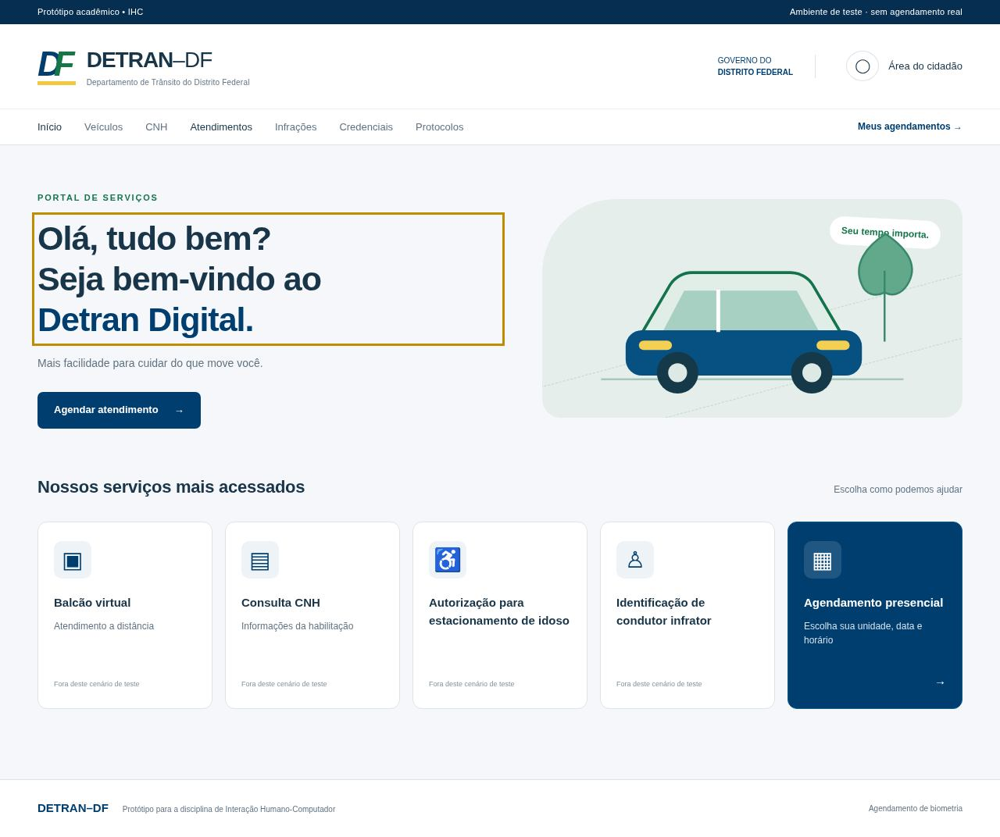
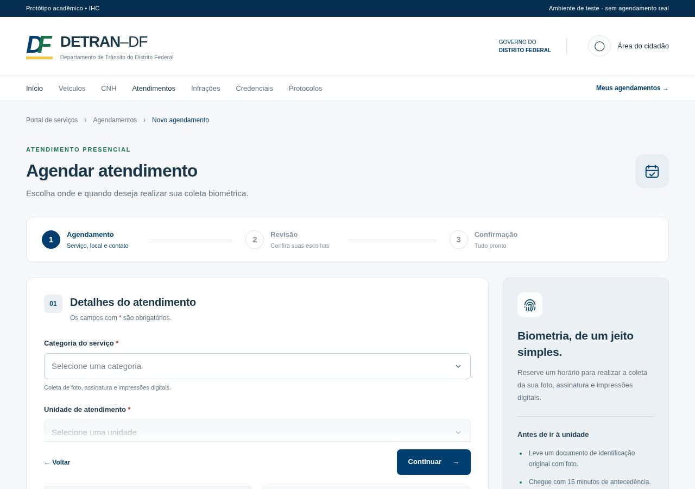
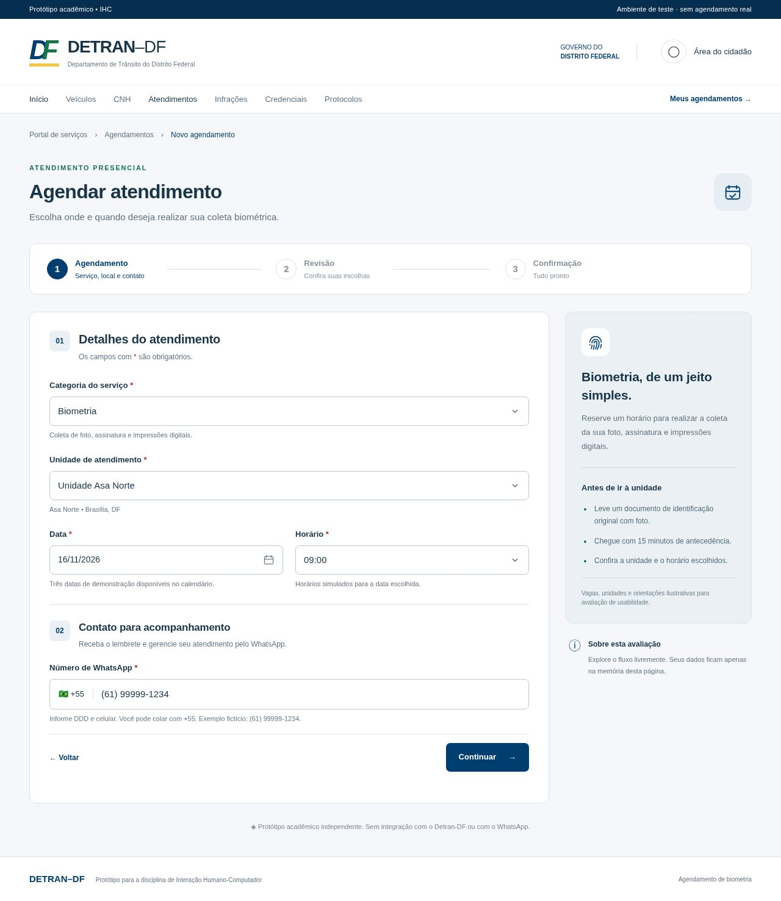
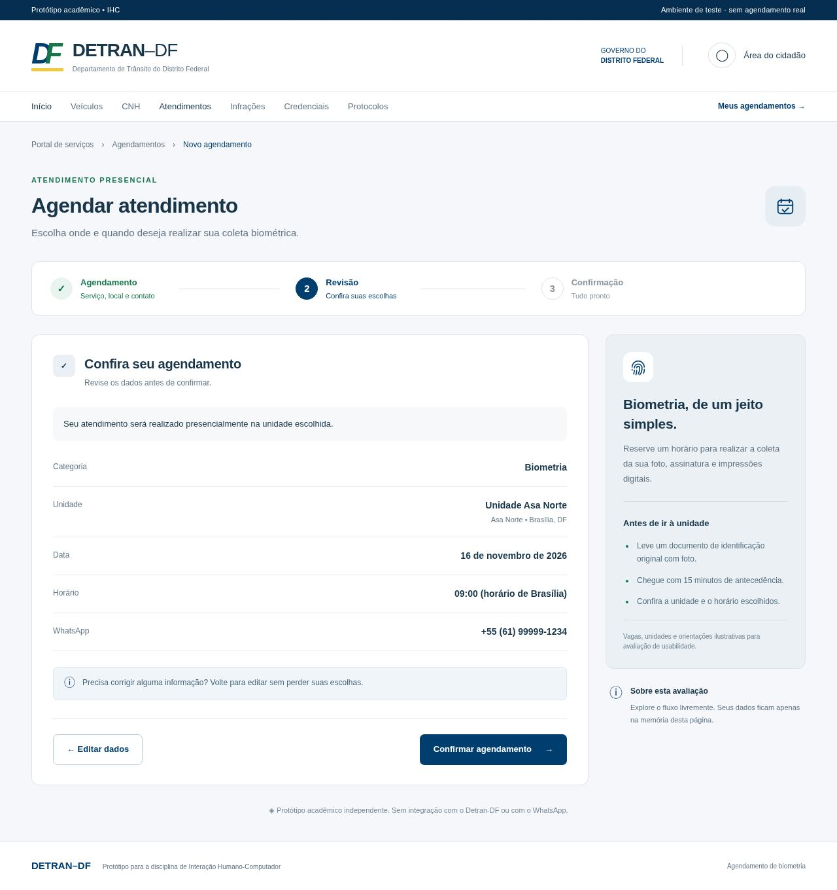
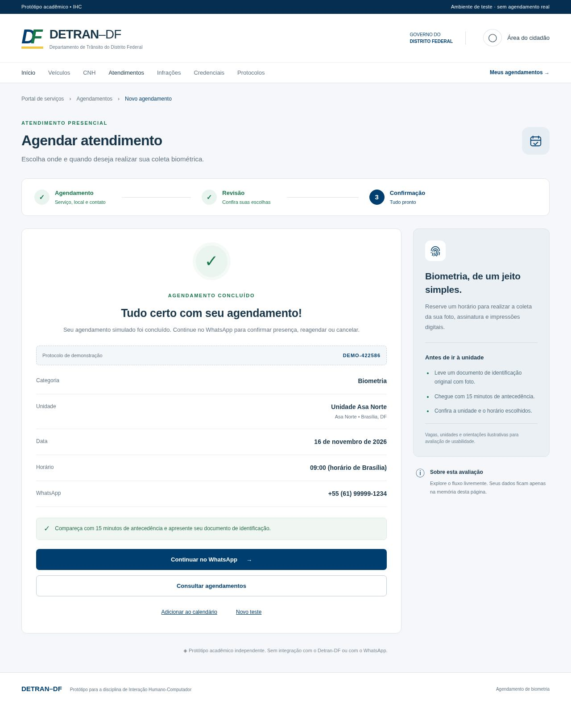
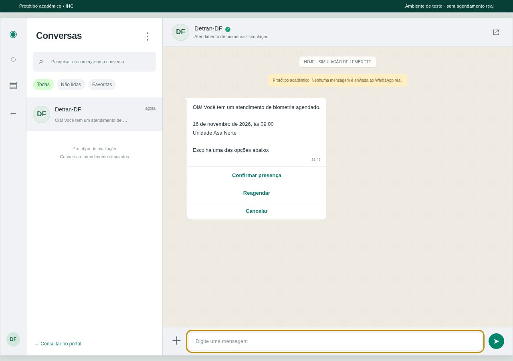
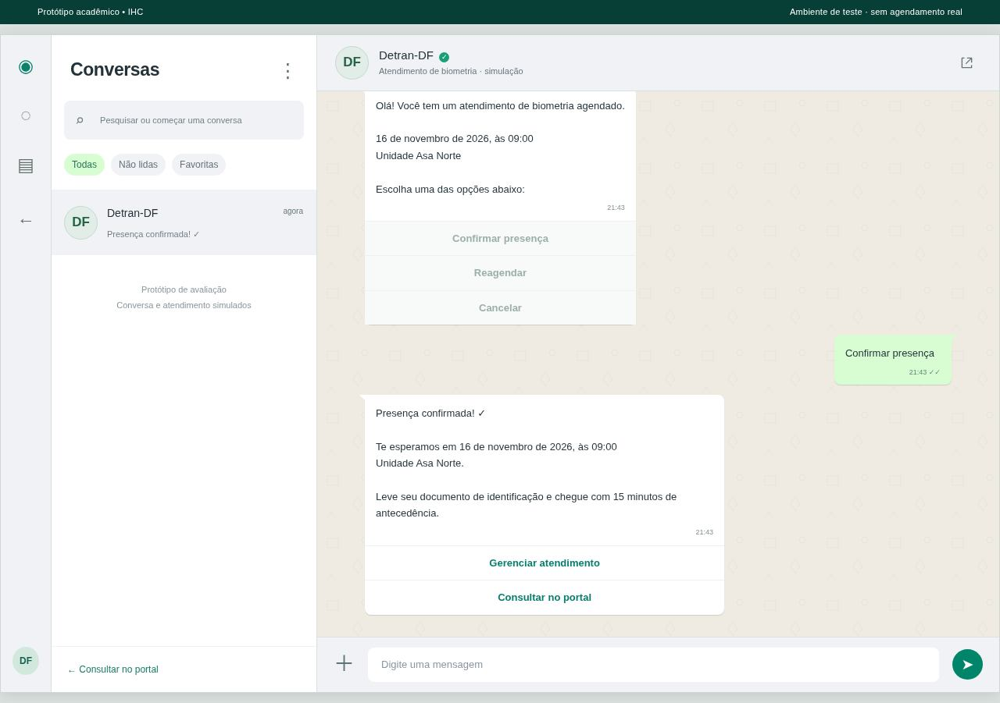
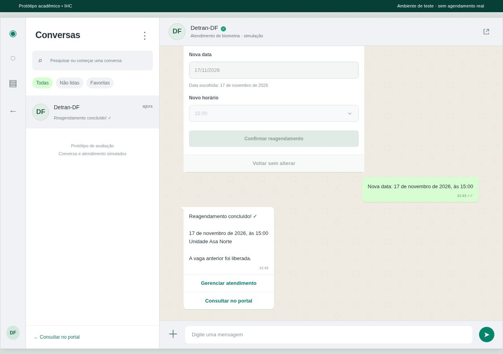
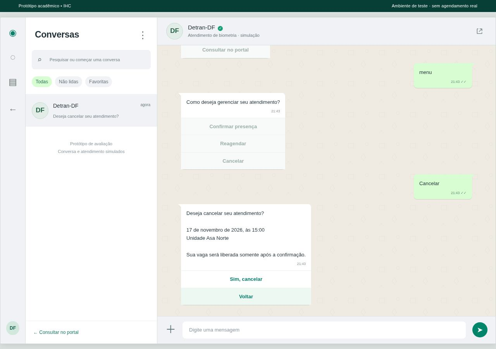
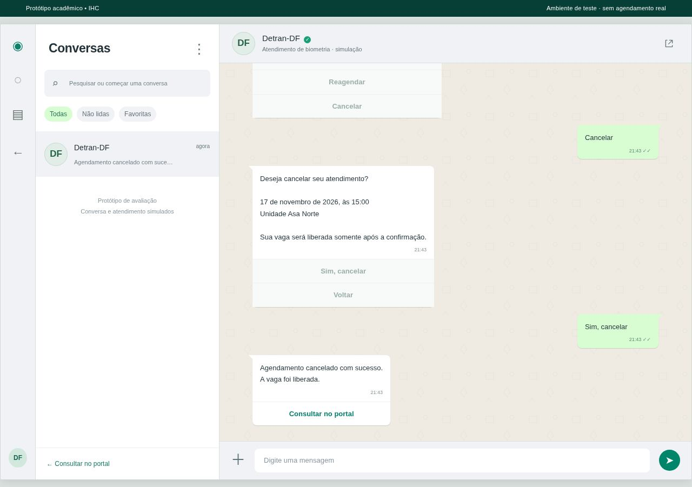

# Protótipo de alta fidelidade – João Vitor

## Tabela de contribuição

**Tabela 1 – Minha contribuição neste artefato**

| Integrante | Contribuição | Atividade | Gravação |
| --- | --- | --- | --- |
| João Vitor | Disponibilização do protótipo interativo, ZIP e capturas da implementação | [Minha entrega](index.md) | [Gravações da avaliação](relato.md#gravacoes) |

Fonte: elaboração do autor (2026).

## Histórico de versões

**Tabela 2 – Histórico de versões**

| Data | Versão | Descrição | Autor | Revisor |
| --- | --- | --- | --- | --- |
| 14/11/2026 | 1.0 | Inclusão do fluxo completo de biometria com WhatsApp simulado no Pages | João Vitor | Revisão humana pendente |
| 15/11/2026 | 1.1 | Vinculação das gravações e atualização da situação da análise preliminar | João Vitor | Revisão humana pendente |
| 15/11/2026 | 1.2 | Atualização das datas de aplicação e da situação do relato com o complemento de P03 | João Vitor | Revisão humana pendente |

Fonte: registro desta versão (2026).

## 1. Introdução {#introducao}

Disponibilizei aqui o protótipo de alta fidelidade do **agendamento e gerenciamento de biometria**, seguindo meu fluxo no papel. A versão contém o portal e a tela simulada do WhatsApp. As unidades, datas, horários, telefone e protocolo são dados de demonstração; nenhum atendimento real é criado.

## 2. Protótipo interativo {#prototipo-interativo}

É possível navegar no próprio Pages pelo quadro abaixo. Para usar toda a janela, [abra o protótipo em outra aba](arquivos/prototipoBiometriaDetran.html){target="_blank" rel="noopener" .md-button}.

<iframe
  title="Protótipo interativo de João Vitor — biometria no Detran-DF e WhatsApp simulado"
  src="../arquivos/prototipoBiometriaDetran.html"
  width="100%"
  height="780"
  style="display: block; width: 100%; height: 80vh; min-height: 520px; max-height: 1000px; border: 1px solid #b6c3d1; border-radius: 8px; background: #f4f6f8;"
  loading="lazy"
  allow="fullscreen"
  allowfullscreen>
</iframe>

O fluxo é **Início → Agendamento presencial → Novo agendamento → Atendimento presencial → Biometria → unidade/data/horário/contato → revisão → confirmação → Continuar no WhatsApp**. Na conversa, é possível confirmar presença, reagendar, desistir da alteração ou confirmar o cancelamento. A consulta no portal reflete o estado atual.

## 3. Download e versão utilizada {#versao}

[Baixar prototipoBiometriaDetran.zip](arquivos/prototipoBiometriaDetran.zip){.md-button .md-button--primary download="prototipoBiometriaDetran.zip"}

O pacote é independente do site externo e inclui `prototipoBiometriaDetran.html` completo e os fontes separados em `codigo-fonte/`. Não contém arquivo `.txt`; a pasta interna também se chama `prototipoBiometriaDetran`. Depois de extrair, basta abrir o HTML no navegador, sem instalação ou internet.

- **Snapshot de referência:** versão documentada nesta página; a mesma implementação é usada no iframe e no ZIP.
- **Opções:** três unidades; três datas futuras de demonstração (próximos dias úteis, calculadas ao abrir) e três horários por unidade.
- **Unidade Asa Norte:** 08h00, 09h00 e 15h00. **Taguatinga:** 09h30, 14h30 e 15h30. **Gama:** 08h00, 11h00 e 13h00.
- **Contato de teste:** (61) 99999-1234. O campo aceita número com ou sem +55; os campos começam vazios.
- **Estado:** um atendimento por sessão; recarregar ou fechar a página reinicia. Não recarregar entre T1 e T4.
- **Integridade:** SHA-256 do HTML: `6de04f532df0be3f7198767978f4cacc5930c13b0d6fbc1bb3b7611b6537c2f9`.

Antes do piloto, vou registrar as datas de demonstração mostradas, o navegador e a resolução, e manter o mesmo arquivo de referência para as sessões. A passagem do tempo até o lembrete é simulada por Continuar no WhatsApp; não é necessário aguardar até a véspera.

## 4. Capturas e comprovação de implementação {#capturas}

As Figuras 1–10 foram capturadas na execução técnica do meu protótipo. **Não são fotos de sessões com participantes e não comprovam resultados de avaliação.** O telefone visível é fictício. As imagens podem ser ampliadas ao clicar.

### 1. Início do portal e acesso ao agendamento presencial {#captura-01}

A Figura 1 documenta este estado do fluxo.

**Figura 1 – Início do portal e acesso ao agendamento presencial**

Fonte: protótipo de João Vitor, captura técnica em 14/11/2026, sem participantes de avaliação.

### 2. Formulário inicialmente vazio e seleções dependentes {#captura-02}

A Figura 2 documenta este estado do fluxo.

**Figura 2 – Formulário inicialmente vazio e seleções dependentes**

Fonte: protótipo de João Vitor, captura técnica em 14/11/2026, sem participantes de avaliação.

### 3. Categoria, unidade, data, horário e contato preenchidos {#captura-03}

A Figura 3 documenta este estado do fluxo.

**Figura 3 – Categoria, unidade, data, horário e contato preenchidos**

Fonte: protótipo de João Vitor, captura técnica em 14/11/2026, sem participantes de avaliação.

### 4. Revisão exibindo os dados escolhidos {#captura-04}

A Figura 4 documenta este estado do fluxo.

**Figura 4 – Revisão exibindo os dados escolhidos**

Fonte: protótipo de João Vitor, captura técnica em 14/11/2026, sem participantes de avaliação.

### 5. Confirmação do atendimento e continuidade no WhatsApp {#captura-05}

A Figura 5 documenta este estado do fluxo.

**Figura 5 – Confirmação do atendimento e continuidade no WhatsApp**

Fonte: protótipo de João Vitor, captura técnica em 14/11/2026, sem participantes de avaliação.

### 6. Lembrete do WhatsApp com os dados do portal {#captura-06}

A Figura 6 documenta este estado do fluxo.

**Figura 6 – Lembrete do WhatsApp com os dados do portal**

Fonte: protótipo de João Vitor, captura técnica em 14/11/2026, sem participantes de avaliação.

### 7. Resposta de presença confirmada {#captura-07}

A Figura 7 documenta este estado do fluxo.

**Figura 7 – Resposta de presença confirmada**

Fonte: protótipo de João Vitor, captura técnica em 14/11/2026, sem participantes de avaliação.

### 8. Reagendamento com novos dados e liberação simulada da vaga anterior {#captura-08}

A Figura 8 documenta este estado do fluxo.

**Figura 8 – Reagendamento com novos dados e liberação simulada da vaga anterior**

Fonte: protótipo de João Vitor, captura técnica em 14/11/2026, sem participantes de avaliação.

### 9. Confirmação antes de cancelar, com opção de voltar {#captura-09}

A Figura 9 documenta este estado do fluxo.

**Figura 9 – Confirmação antes de cancelar, com opção de voltar**

Fonte: protótipo de João Vitor, captura técnica em 14/11/2026, sem participantes de avaliação.

### 10. Resposta de cancelamento concluído {#captura-10}

A Figura 10 documenta este estado do fluxo.

**Figura 10 – Resposta de cancelamento concluído**

Fonte: protótipo de João Vitor, captura técnica em 14/11/2026, sem participantes de avaliação.

## 5. Limitações e relação com a avaliação {#limites}

A implementação simula a reserva, a liberação da vaga e o WhatsApp; não acessa o Detran, o Gov.br ou o WhatsApp real. As demais categorias e serviços não são cenários funcionais. A HTA prevê autenticação, busca e comprovante PDF, que não estão implementados nesta versão; o resumo e a exportação de calendário não equivalem ao PDF.

O acabamento é uma interpretação dos meus desenhos, não uma cópia visual validada do portal oficial ou do Figma de Alexandre. O [DECIDE](planejamento.md) e o [roteiro](roteiro.md#tarefas) definem a avaliação. As verificações técnicas asseguram a disponibilidade do artefato, mas não substituem o piloto nem demonstram usabilidade para os participantes. Os [vídeos e o relato das aplicações de 14/11/2026](relato.md#gravacoes) estão separados dessas capturas técnicas. O complemento sobre P03 foi registrado a partir das informações do avaliador.

## Referências

BARBOSA, Simone Diniz Junqueira et al. **Interação Humano-Computador e Experiência do Usuário.** 1. ed. Autopublicação, 2021. Seções 7.4 (p. 126–128), 11.7 (p. 258–263), 11.8 (p. 264) e 12.2.1 (p. 288–290).

SALES, André Barros de. **Plano de Ensino de Interação Humano-Computador, 2026.2.** Universidade de Brasília, 2026. [Documento do projeto](../../../disciplina/plano-de-ensino.md).

JOÃO VITOR. **Planejamento da avaliação do protótipo de alta fidelidade – Entrega 6.** 2026. [Planejamento anterior](../../../entrega-6/integrantes/joao-vitor/planejamento-alta-fidelidade.md).

## Agradecimentos e uso de IA generativa

Utilizei o ChatGPT (OpenAI) como apoio à implementação do protótipo em HTML, CSS e JavaScript, à organização das páginas, à adaptação dos instrumentos e à verificação técnica dos arquivos e links. A estrutura da área de Alexandre Vilar serviu como referência de organização. As capturas do meu protótipo foram produzidas em execução técnica; não são registros de avaliação com participantes. O apoio de IA não substitui a revisão humana nem a realização do piloto e das sessões. A responsabilidade pelo conteúdo publicado e por sua conferência acadêmica é minha.

Em 15/11/2026, o ChatGPT apoiou a revisão da redação e das tabelas. Confirmei as aplicações em 14/11/2026 e complementei o relato de P03 com a mudança de data e o reagendamento. A responsabilidade pela conferência do material é minha.
