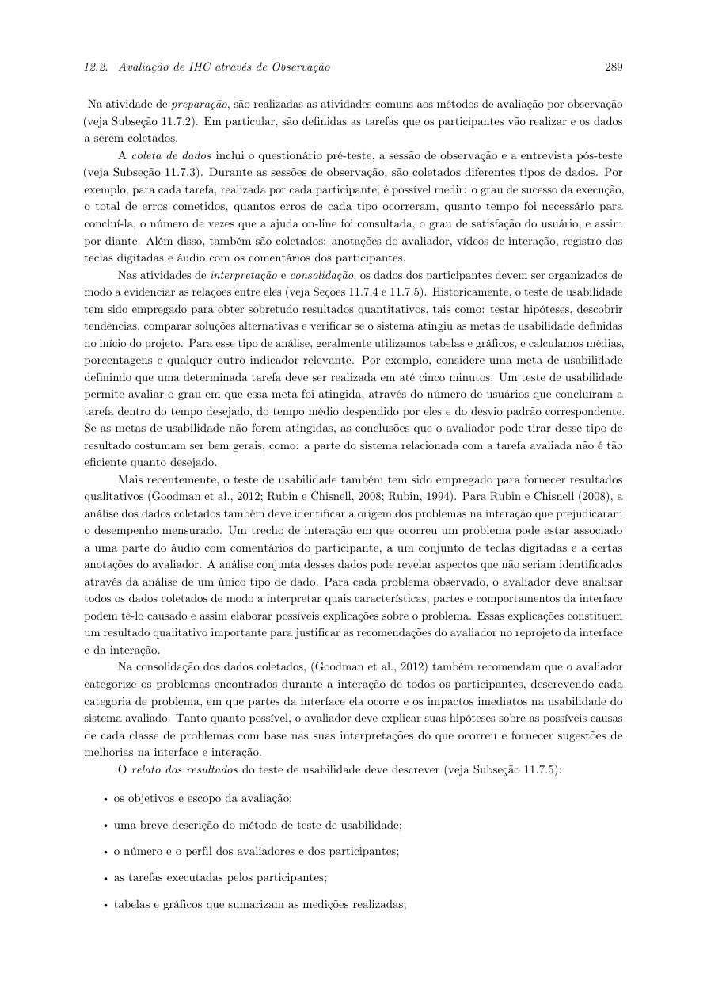

# Relato dos resultados da avaliação – João Vitor

## Tabela de contribuição

**Tabela 1 – Minha contribuição neste artefato**

| Integrante | Contribuição | Atividade | Gravação |
| --- | --- | --- | --- |
| João Vitor | Análise preliminar das gravações e organização das evidências temporais | [Minha entrega](index.md) | [Gravações da avaliação](relato.md#gravacoes) |

Fonte: elaboração do autor (2026).

## Histórico de versões

**Tabela 2 – Histórico de versões**

| Data | Versão | Descrição | Autor | Revisor |
| --- | --- | --- | --- | --- |
| 14/11/2026 | 1.0 | Modelo de relato preparado com sessões, resultados e gravações pendentes | João Vitor | Revisão humana pendente |
| 15/11/2026 | 1.1 | Vinculação de quatro gravações e análise preliminar das legendas, com limites de verificação explicitados | João Vitor | Revisão humana pendente |

Fonte: registro desta versão (2026).

## 1. Situação e alcance da análise {#situacao}

Recebi quatro links identificados como teste-piloto, P01, P02 e P03. Esta versão apresenta uma **análise preliminar das falas registradas nas legendas automáticas do YouTube**, consultadas em 15/11/2026. Não corresponde a uma inspeção visual integral das gravações.

As legendas do registro apresentado como piloto, de P01 e de P02 estão em português e permitem localizar verbalizações sobre o uso do protótipo. Para **P03**, o YouTube disponibilizou à ferramenta somente cinco segmentos automáticos em inglês, sem conteúdo suficiente para analisar a sessão. Mantive esse registro como **análise pendente**, sem atribuir falha à pessoa participante.

Não foi possível reproduzir os vídeos no navegador deste ambiente para conferir quadros, cliques e estados finais da interface. Portanto, diferenciei **conclusão verbalizada**, **orientação do moderador** e **resultado visual não verificado**. Não calculei tempos de execução, taxa de sucesso ou contagem de erros a partir das legendas. A ausência de menção de um evento não comprova que ele não aconteceu.

### Gravações fornecidas {#gravacoes}

A Tabela 3 mantém os códigos fornecidos pelo responsável. A data da aplicação ainda não foi informada; não utilizei o dia de publicação ou de consulta como data de realização das sessões.

**Tabela 3 – Fontes e disponibilidade para análise**

| Registro | Gravação | Data da aplicação | Fonte efetivamente acessada | Uso nesta versão |
| --- | --- | --- | --- | --- |
| Vídeo apresentado como piloto | [TESTE PILOTO](https://www.youtube.com/watch?v=0q2Ko2J0udM) | Não informada | Legenda automática em português | Demonstração narrada; participação externa e procedimento de piloto não comprovados pela legenda; fora da consolidação dos participantes |
| P01 | [ENTREVISTA PROTOTIPO ALTA FIDELIDADE P01](https://www.youtube.com/watch?v=uybHtUtdJoY) | Não informada | Legenda automática em português | Análise textual preliminar de agendamento e confirmação de presença |
| P02 | [ENTREVISTA PROTOTIPO ALTA FIDELIDADE P02](https://www.youtube.com/watch?v=jFsENSShwhQ) | Não informada | Legenda automática em português | Análise textual preliminar de agendamento e confirmação de presença |
| P03 | [ENTREVISTA PROTOTIPO ALTA FIDELIDADE P03](https://www.youtube.com/watch?v=rIH_GDsRM5s) | Não informada | Legenda automática em inglês, cinco segmentos sem sequência compreensível | Pendente de transcrição confiável ou conferência audiovisual |

Fonte: links identificados pelo responsável e legendas automáticas recuperadas em 15/11/2026.

As marcas de tempo abaixo são **referências aproximadas do início de segmentos de legenda**, úteis para reencontrar a fala. Não delimitam necessariamente início e fim de tarefa. As legendas podem errar termos como IHC, *think-aloud* e Asa Norte e não fornecem identificação confiável de todos os falantes. Na dúvida de atribuição, descrevi a verbalização da gravação sem atribuí-la automaticamente ao participante.

## 2. Objetivos, método e execução documentada {#estrutura}

O objetivo planejado foi avaliar o agendamento da biometria e seu gerenciamento pelo WhatsApp simulado, respondendo Q1–Q7. O método previsto é teste de usabilidade moderado por observação com pensar em voz alta, entrevistas de apoio e tarefas T1–T4, conforme o [DECIDE](planejamento.md#decide) e o [roteiro](roteiro.md#tarefas).

Nas aberturas de P01 ([00:11](https://www.youtube.com/watch?v=uybHtUtdJoY&t=11s)–00:27) e P02 ([00:09](https://www.youtube.com/watch?v=jFsENSShwhQ&t=9s)–00:31), o moderador pede que a pessoa verbalize o que está pensando enquanto realiza o agendamento. Essa orientação é compatível com a técnica de pensar em voz alta. Em P02, também é informado que os dados podem ser fictícios ([00:20](https://www.youtube.com/watch?v=jFsENSShwhQ&t=20s)–00:31).

A interpretação segue Barbosa et al. (2021, seções 11.7.5 e 12.2.1). A Figura 1 mantém a fundamentação bibliográfica do relato, sem funcionar como evidência de uma sessão.

**Figura 1 – Medições, interpretação e apresentação do relato de usabilidade**

Fonte: Barbosa et al. (2021), p. 289. Trecho disponibilizado na área de Alexandre, reutilizado como fundamentação teórica.

### Participantes e contexto {#participantes}

Foram fornecidos **três registros identificados como P01, P02 e P03**. Nesta versão, somente P01 e P02 têm conteúdo textual suficiente para uma análise preliminar. Não inferi idade, experiência com o portal, perfil de recrutamento, identidade ou características pessoais a partir da voz, do título ou dos códigos.

O plano previa dois participantes definitivos e uma pessoa para o piloto. A entrega de três registros identificados como participantes amplia o conjunto em relação à previsão e deve ser registrada como diferença do plano. Não contei o vídeo apresentado como piloto como uma quarta pessoa participante.

As datas e horários efetivos, o local, o navegador, a resolução usada e as autorizações de participação/gravação/divulgação ainda precisam ser confirmados. A ausência dessas informações nas legendas não prova que os procedimentos não ocorreram fora do trecho gravado. Não publiquei termos assinados, contatos pessoais ou caracterizações não fornecidas.

### Tarefas efetivamente evidenciadas e intervenções {#tarefas-reais}

Em P01 e P02, a orientação inicial é aberta: agendar biometria e escolher dados durante o uso. Isso difere do cenário padronizado de T1, que previa a primeira data disponível às 09h00. P01 verbaliza o dia 18 e 15h00; P02 verbaliza 16 de novembro e 09h00. Não completei mês, ano ou outros campos não explicitados em cada fala por suposição.

As duas legendas registram a passagem ao WhatsApp e falas sobre confirmar presença. Não apresentam evidência textual suficiente de execução de reagendamento e cancelamento pelos participantes. Isso deixa **T3 e T4 não verificadas nesta análise**, em vez de classificá-las como falha ou como sucesso.

Há orientações procedimentais durante o uso, além da explicação inicial:

- Em P01, há orientação para conferir/confirmar os dados em [01:05](https://www.youtube.com/watch?v=uybHtUtdJoY&t=65s) e explicação das opções do WhatsApp em [01:18](https://www.youtube.com/watch?v=uybHtUtdJoY&t=78s)–01:27.
- Em P02, o moderador indica clicar em Continuar no WhatsApp em [01:14](https://www.youtube.com/watch?v=jFsENSShwhQ&t=74s)–01:21 e consultar no portal em [01:23](https://www.youtube.com/watch?v=jFsENSShwhQ&t=83s)–01:29.

Por isso, não classifiquei os percursos como conclusão comprovadamente independente de ajuda. A intervenção foi registrada como condição da condução, sem convertê-la automaticamente em problema de interface.

## 3. Evidências por gravação {#evidencias}

### P01 {#p01}

A Tabela 4 reúne os trechos úteis da legenda. O resultado permanece verbal, com tela não conferida.

**Tabela 4 – Evidências textuais de P01**

| Trecho aproximado | Registro na legenda | Interpretação possível / limite |
| --- | --- | --- |
| [00:29](https://www.youtube.com/watch?v=uybHtUtdJoY&t=29s)–00:37 | Início do agendamento e menção ao atendimento presencial | Indício de reconhecimento do caminho; percurso de cliques não conferido |
| [00:42](https://www.youtube.com/watch?v=uybHtUtdJoY&t=42s)–00:46 | Pedido “Dá o pause” após solicitação para parar a gravação | Preciso confirmar se houve pausa/corte; não medir tempo contínuo por esse vídeo |
| [00:45](https://www.youtube.com/watch?v=uybHtUtdJoY&t=45s)–01:05 | Biometria, unidade verbalizada como Asa Norte, dia 18 e horário 15h00 | Escolhas verbalizadas; divergência em relação ao cenário fechado de T1 e valores finais não conferidos na tela |
| [01:05](https://www.youtube.com/watch?v=uybHtUtdJoY&t=65s)–01:13 | Orientação sobre confirmação e fala “Beleza. Confirmei.” | Conclusão do agendamento verbalizada após orientação; sem comprovação visual independente |
| [01:11](https://www.youtube.com/watch?v=uybHtUtdJoY&t=71s)–01:27 | Passagem ao WhatsApp, explicação da passagem de tempo e das opções | Continuidade acompanhada por explicação verbal |
| [01:25](https://www.youtube.com/watch?v=uybHtUtdJoY&t=85s)–01:34 | “Certo. Vou confirmar” e menção à consulta no portal | Intenção/verbalização de confirmar presença; estado final visual não verificado |

Fonte: legenda automática em português do vídeo P01, consultada em 15/11/2026.

### P02 {#p02}

A Tabela 5 reúne os trechos úteis de P02, com os mesmos limites de interpretação.

**Tabela 5 – Evidências textuais de P02**

| Trecho aproximado | Registro na legenda | Interpretação possível / limite |
| --- | --- | --- |
| [00:20](https://www.youtube.com/watch?v=jFsENSShwhQ&t=20s)–00:34 | Orientação de usar dados fictícios e agendar biometria | Instrução de cenário aberto, sem fixar a combinação original da tarefa |
| [00:34](https://www.youtube.com/watch?v=jFsENSShwhQ&t=34s)–00:49 | Atendimento presencial, Biometria, Asa Norte, 16 de novembro e 09h00 | Sequência e escolhas verbalizadas; valores exibidos não conferidos |
| [01:04](https://www.youtube.com/watch?v=jFsENSShwhQ&t=64s)–01:14 | Menção a confirmar o agendamento e passagem anunciada à etapa seguinte | Indício verbal de avanço, sem delimitação validada de conclusão da tarefa |
| [01:14](https://www.youtube.com/watch?v=jFsENSShwhQ&t=74s)–01:21 | Orientação para clicar em Continuar no WhatsApp e explicação do lembrete | Apoio procedimental explícito; não considerar navegação independente |
| [01:21](https://www.youtube.com/watch?v=jFsENSShwhQ&t=81s)–01:33 | Menção à confirmação de presença, consulta e conferência de “local, data, horário, certinho” | Verbalização compatível com conferência dos dados; não equivale a verificação visual do registro |

Fonte: legenda automática em português do vídeo P02, consultada em 15/11/2026.

### P03 {#p03}

A gravação está vinculada, mas a legenda automática disponível à ferramenta está em inglês e contém somente cinco segmentos isolados. Não extraí dela tarefas, opiniões, erros, conclusão, ajuda ou tempos. Essa insuficiência é **da fonte de análise**, não um resultado negativo do participante. Para completar a sessão, preciso de transcrição confiável, anotações confirmadas ou acesso audiovisual utilizável.

## 4. Consolidação das tarefas {#consolidacao}

A Tabela 6 distingue presença de evidência de sucesso observado. Não calculei taxas agregadas, médias de tempo ou quantidade de erros.

**Tabela 6 – Estado da evidência por participante e tarefa**

| Registro | Tarefa | Evidência disponível | Classificação nesta análise | Tempo / contagem de erros |
| --- | --- | --- | --- | --- |
| P01 | T1 – Agendar | Escolhas e “Confirmei”, com orientação ([00:45](https://www.youtube.com/watch?v=uybHtUtdJoY&t=45s)–01:13) | Conclusão verbalizada; valores/tela e independência não verificados | Não mensurados |
| P01 | T2 – Presença | Verbalização de confirmar e consultar ([01:18](https://www.youtube.com/watch?v=uybHtUtdJoY&t=78s)–01:34) | Há evidência textual de uso da etapa; estado final não conferido | Não mensurados |
| P01 | T3 / T4 | Sem evidência textual suficiente no registro acessado | Não verificadas; não classificar como falha | Não mensurados |
| P02 | T1 – Agendar | Seleções e passagem verbal ao WhatsApp ([00:34](https://www.youtube.com/watch?v=jFsENSShwhQ&t=34s)–01:21) | Avanço verbalizado; resultado visual e independência não verificados | Não mensurados |
| P02 | T2 – Presença | Confirmação/conferência verbalizadas, com condução ([01:21](https://www.youtube.com/watch?v=jFsENSShwhQ&t=81s)–01:33) | Evidência textual parcial; estado final não conferido | Não mensurados |
| P02 | T3 / T4 | Sem evidência textual suficiente no registro acessado | Não verificadas; não classificar como falha | Não mensurados |
| P03 | T1–T4 | Legenda insuficiente para reconstruir o uso | Análise pendente por limitação da fonte | Não mensurados |

Fonte: consolidação das legendas de P01 e P02; P03 mantido como pendente. O registro apresentado como piloto não foi incluído como participante.

### Respostas provisórias ao DECIDE {#respostas-decide}

Na Tabela 7, relacionei as evidências a Q1–Q7 sem extrapolar o alcance da fonte.

**Tabela 7 – Questões de avaliação e situação da resposta**

| Questão | Resposta preliminar |
| --- | --- |
| Q1 – Encontrar o serviço | P01 e P02 verbalizam atendimento presencial e Biometria; o percurso visual não foi auditado |
| Q2 – Selecionar e informar contato | Há escolhas verbalizadas; não confirmei os campos efetivos nem sua correção frente ao resumo |
| Q3 – Revisar e confirmar | Há falas de confirmação e avanço; não houve uma pergunta pós-teste registrada que estabeleça toda a compreensão |
| Q4 – Confirmar presença pelo lembrete | Há verbalização dessa etapa em P01 e P02, com explicação do moderador; não comprova autonomia |
| Q5 – Reagendar e compreender a vaga anterior | Sem evidência suficiente dos participantes nos registros textuais acessados |
| Q6 – Cancelar e voltar sem cancelar | Sem evidência suficiente dos participantes nos registros textuais acessados |
| Q7 – Obstáculos e sugestões | Não há entrevista pós-teste estruturada nem sugestões claramente registradas nas legendas; não inferi satisfação ou ausência de problemas |

Fonte: análise preliminar relacionada ao [planejamento](planejamento.md#perguntas).

## 5. Problemas, limitações e encaminhamentos {#problemas}

Não atribuí bugs ou problemas de interface aos participantes sem evidência suficiente. A Tabela 8 apresenta **limitações do registro e do procedimento** e ações propostas; não é uma lista de defeitos comprovados da aplicação.

**Tabela 8 – Limitações metodológicas e ações de complementação**

| ID | Evidência / situação | Efeito sobre a análise | Encaminhamento proposto |
| --- | --- | --- | --- |
| M01 | Cenário aberto e escolhas diferentes do T1 padronizado | Impede tratar os casos como execução idêntica do cenário planejado | Registrar a tarefa efetiva e padronizar os próximos enunciados |
| M02 | Orientações de confirmação/WhatsApp durante o uso | Não comprova navegação independente | Separar instrução inicial de ajuda durante a tarefa e anotar cada intervenção |
| M03 | Pedido de pausa em P01 ([00:42](https://www.youtube.com/watch?v=uybHtUtdJoY&t=42s)) | Tempo contínuo e possíveis cortes não estabelecidos | Confirmar a pausa/edição e usar registros brutos/cronômetro para mensuração, se disponíveis |
| M04 | Somente legendas acessíveis; P03 sem transcrição útil | Não permite auditoria visual nem análise completa de P03 | Conferir gravações e obter fonte textual confiável antes da versão consolidada |
| M05 | T3/T4 sem evidência textual suficiente dos participantes | Cobertura da bateria não demonstrada | Verificar se houve outros trechos/sessões e complementar a coleta quando necessário |
| M06 | Datas, perfil, consentimento e logística sem confirmação completa | Contexto e aderência ao planejamento incompletos | Completar com registros reais; não inferir da publicação dos vídeos |

Fonte: condições encontradas nesta análise preliminar; prioridades e correções de interface dependerão da complementação das evidências.

## 6. Registro apresentado como piloto {#piloto}

No início do vídeo, João se apresenta e anuncia um teste-piloto/demonstração ([00:00](https://www.youtube.com/watch?v=0q2Ko2J0udM&t=0s)–00:15). A legenda acompanha a apresentação do agendamento, a confirmação e a passagem ao WhatsApp. Há demonstração narrada de presença ([01:05](https://www.youtube.com/watch?v=0q2Ko2J0udM&t=65s)), reagendamento ([01:11](https://www.youtube.com/watch?v=0q2Ko2J0udM&t=71s)–01:29) e cancelamento ([01:26](https://www.youtube.com/watch?v=0q2Ko2J0udM&t=86s)–01:36).

Esse conteúdo ajuda a documentar o fluxo demonstrado pelo autor. A legenda, porém, não estabelece a participação de uma pessoa distinta da preparação nem a aplicação integral do roteiro do piloto. **Não o tratei como comprovação de um piloto metodológico completo ou como quarta pessoa participante.** A caracterização será ajustada quando o responsável confirmar quem participou e em que data.

Mantive o registro separado da consolidação. Não transferi as ações de reagendar/cancelar dessa demonstração para os resultados de P01, P02 ou P03 e não presumi ajustes entre piloto e sessões.

## 7. Complementos necessários {#plano-relato}

Para consolidar o relatório, ainda preciso:

1. Confirmar a data de cada aplicação e a caracterização do vídeo apresentado como piloto.
2. Conferir visualmente os estados finais e a versão efetivamente usada.
3. Obter fonte confiável para P03.
4. Verificar se T3/T4 foram aplicadas em outros trechos e registrar a bateria efetiva, sem presumir sua realização.
5. Completar perfil agregado, logística, consentimento e eventuais pausas/cortes.
6. Incluir pós-teste e sugestões, se tiverem sido coletados, e receber revisão humana.

O [cronograma da Entrega 6](planejamento.md#cronograma) permanece como previsão histórica. Os links recebidos não preenchem automaticamente suas datas de execução. A apresentação específica da Entrega 7 também continua sem identificação confirmada entre estes quatro registros.

## Referências

BARBOSA, Simone Diniz Junqueira et al. **Interação Humano-Computador e Experiência do Usuário.** 1. ed. Autopublicação, 2021. Seções 7.4 (p. 126–128), 11.7 (p. 258–263), 11.8 (p. 264) e 12.2.1 (p. 288–290).

SALES, André Barros de. **Plano de Ensino de Interação Humano-Computador, 2026.2.** Universidade de Brasília, 2026. [Documento do projeto](../../../disciplina/plano-de-ensino.md).

JOÃO VITOR. **Planejamento da avaliação do protótipo de alta fidelidade – Entrega 6.** 2026. [Planejamento anterior](../../../entrega-6/integrantes/joao-vitor/planejamento-alta-fidelidade.md).

## Agradecimentos e uso de IA generativa

Utilizei o ChatGPT (OpenAI) como apoio para organizar o relato e relacionar os trechos temporizados das legendas às tarefas e questões do DECIDE. O texto das legendas automáticas foi recuperado do YouTube por meio do Firecrawl. Essa análise não incluiu inspeção visual integral ou audição independente dos vídeos; P03 ficou pendente por insuficiência da legenda. Mantive a autoria das tabelas como João Vitor e explicitei as limitações para que a síntese seja conferida antes de sua consolidação acadêmica.
