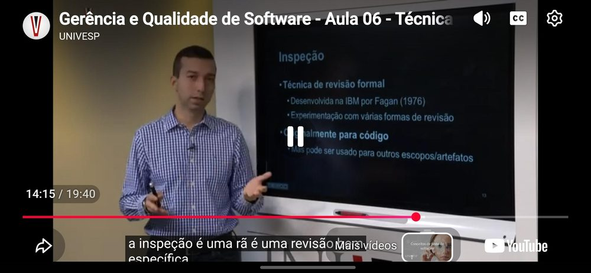
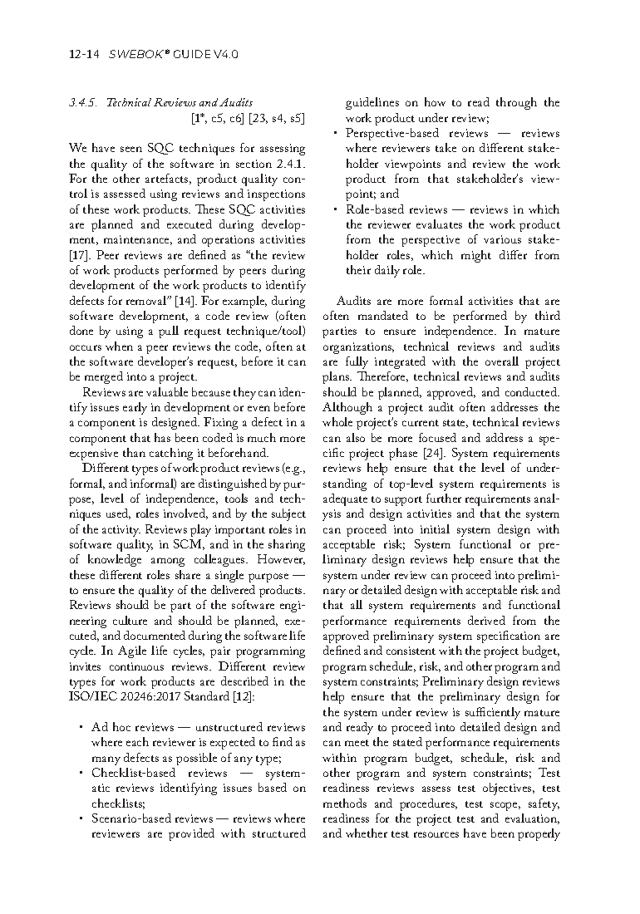
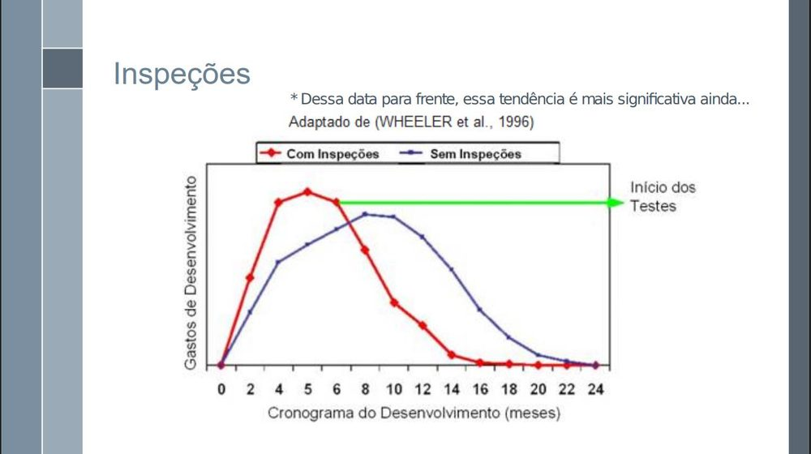
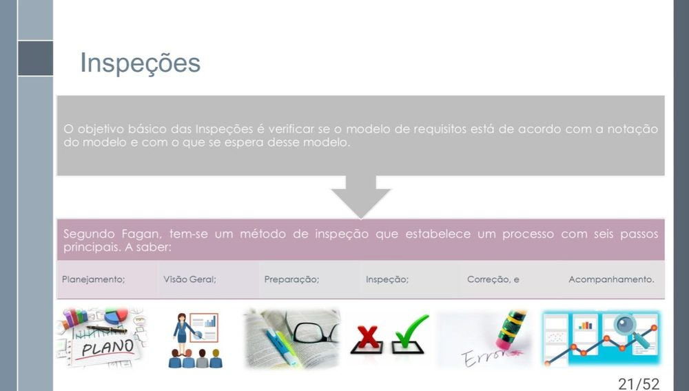
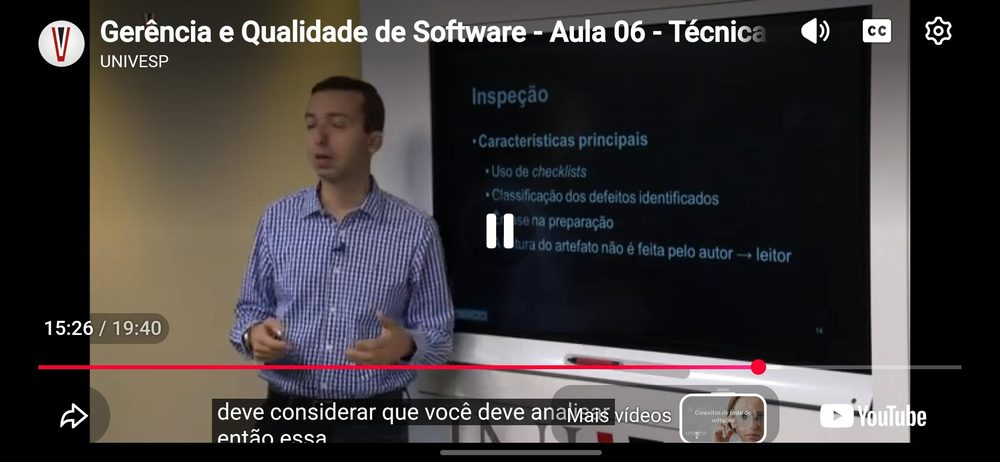

# Inspeção de Fagan – Material Conceitual e Planejamento

## Tabela de contribuição

**Tabela 1 – Contribuição no artefato Inspeção de Fagan – Material Conceitual e Planejamento**

| Integrante | Contribuição | Atividade (link) | Gravação (link) |
| --- | --- | --- | --- |
| Alexandre Vilar Valadares Fonsêca | Participação na reunião de inspeção do próprio grupo (visão geral, inspeção e conferência) | [Inspeção de Fagan](index.md) | [Reunião de inspeção do grupo](https://youtu.be/PXa3Pye4lW4) |
| Gabriel Robson Nunes Neiva da Silva (ex-integrante) | — | — | — |
| Henrique Schneider Fernandes da Rosa | Decisão de aplicar a inspeção de Fagan com uma lista por artefato; levantamento do material conceitual; planejamento, preparação, correção e acompanhamento da inspeção; condução da reunião de inspeção do próprio grupo | [Inspeção de Fagan](index.md) | [Reunião de inspeção do grupo](https://youtu.be/PXa3Pye4lW4) |
| João Vitor Tavares de Sá Lima | Participação na reunião de inspeção do próprio grupo, como leitor dos itens (visão geral, inspeção e conferência) | [Inspeção de Fagan](index.md) | [Reunião de inspeção do grupo](https://youtu.be/PXa3Pye4lW4) |

Fonte: elaborado pelos autores (2026).

## Histórico de versões

**Tabela 2 – Histórico de versões do artefato Inspeção de Fagan – Material Conceitual e Planejamento**

| Data | Versão | Descrição | Autor(es) | Revisor(es) |
| --- | --- | --- | --- | --- |
| 19/11/2026 | 0.1 | Criação da página com o material conceitual da inspeção de Fagan, o planejamento da inspeção dos artefatos e o formato das listas | Henrique Schneider (solicitante), com apoio do Claude (IA generativa) | João Vitor |
| 22/11/2026 | 0.2 | Registro da correção e do acompanhamento (passos 5 e 6), inclusão das páginas gerais do site entre os objetos da inspeção, dos itens do Plano de Ensino sobre a avaliação do projeto e do resultado depois da correção | Henrique Schneider (solicitante), com apoio do Claude (IA generativa) | João Vitor |
| 22/11/2026 | 0.3 | Troca do revisor Gabriel Robson, que deixou o grupo, por João Vitor no histórico de versões; sinalização dos ex-integrantes na tabela de contribuição | Henrique Schneider (solicitante), com apoio do Claude (IA generativa) | João Vitor |
| 22/11/2026 | 0.4 | Exclusão da inspeção dos itens de ex-integrantes (Camile Barbosa, Eduardo Ribeiro e Gabriel Robson) e novo cálculo do resultado | Henrique Schneider (solicitante), com apoio do Claude (IA generativa) | Alexandre Vilar |
| 22/11/2026 | 0.5 | Inclusão da foto da página do SWEBOK (nova Figura 2) e renumeração das figuras seguintes, conforme a exigência do Plano de Ensino de trazer a foto de cada fonte | Henrique Schneider (solicitante), com apoio do Claude (IA generativa) | Alexandre Vilar |
| 22/11/2026 | 0.6 | Registro da reunião gravada de inspeção do próprio grupo (passos 2, 4 e 6), com o link do vídeo, o título e a descrição; registro de que a inspeção dos grupos +1 e −1, prevista para a mesma reunião, ficou para outra reunião por causa do tamanho da lista de verificação | Henrique Schneider (solicitante), com apoio do Claude (IA generativa) | João Vitor |
Fonte: elaborado pelos autores (2026).

## 1. Introdução

A Entrega 8 é a “Verificação dos artefatos” e vence em 22/11/2026, às 23:59 (Sales, 2026, p. 4). O grupo decidiu fazer essa verificação com a **técnica de inspeção de Fagan**, aplicando **uma lista de inspeção a cada artefato** do projeto. Esta página reúne o material conceitual da técnica (Seção 2), mostra como ela é aplicada ao projeto (Seção 3) e explica o formato das listas (Seção 4). As listas de cada entrega e o resultado da preparação estão nas páginas indicadas no Quadro 3.

## 2. Material conceitual

### 2.1 Inspeção como técnica de verificação

Verificar é conferir se um produto de trabalho atende ao que foi especificado para ele. A inspeção é uma das formas de revisão formal: segundo a Univesp ([20--], aula 06, 13:55), os tipos formais de revisão são a revisão gerencial, a revisão técnica (que inclui o *walkthrough*), a inspeção e a auditoria. A inspeção é uma “técnica de revisão formal”, “desenvolvida na IBM por Fagan (1976)”, “originalmente para código”, mas que “pode ser usado para outros escopos/artefatos” (Univesp, [20--], aula 06, 14:15), como mostra a Figura 1. É por isso que ela serve para os artefatos de IHC deste projeto, que são documentos, e não código.

**Figura 1 – Inspeção como técnica de revisão formal desenvolvida por Fagan**

Fonte: Univesp ([20--], aula 06, 14:15).

Serrano e Serrano ([20--], slide 21) resumem o objetivo das inspeções como verificar se o artefato “está de acordo com a notação do modelo e com o que se espera desse modelo”. O SWEBOK classifica esse tipo de verificação entre as revisões técnicas e registra, entre os tipos de revisão da norma ISO/IEC 20246:2017, as **revisões baseadas em lista de verificação** (*checklist-based reviews*), que identificam problemas de forma sistemática a partir de uma lista (Washizaki, 2024, cap. 12, seç. 3.4.5, p. 12-14). O mesmo trecho lembra que corrigir um defeito depois que o produto está pronto custa mais do que encontrá-lo antes. A Figura 2 mostra a página do SWEBOK citada.

**Figura 2 – Revisões técnicas e revisões baseadas em lista de verificação (SWEBOK v4)**

{ width="480" }

Fonte: Washizaki (2024, cap. 12, seç. 3.4.5, p. 12-14).

### 2.2 Por que inspecionar cedo

A Figura 3, que Serrano e Serrano ([20--], slide 20) adaptam de Wheeler *et al.* (1996), compara os gastos de desenvolvimento de projetos com e sem inspeções: com inspeções, o gasto sobe no início e cai antes do início dos testes; sem inspeções, o pico vem depois e se estende por mais tempo.

**Figura 3 – Gastos de desenvolvimento com e sem inspeções**

Fonte: Serrano e Serrano ([20--], slide 20), adaptado de Wheeler *et al.* (1996).

### 2.3 Os seis passos de Fagan

Segundo Serrano e Serrano ([20--], slide 21), o método de inspeção de Fagan estabelece um processo com seis passos principais: **planejamento, visão geral, preparação, inspeção, correção e acompanhamento** (Figura 4). O Quadro 1 descreve cada passo como ele aparece nas respostas dos integrantes à lista de exercícios de verificação da Entrega 1, que se apoiam nessa mesma fonte e na videoaula da Univesp.

**Figura 4 – Os seis passos do método de inspeção de Fagan**

Fonte: Serrano e Serrano ([20--], slide 21).

**Quadro 1 – Passos da inspeção de Fagan**

| Passo | O que se faz |
| --- | --- |
| 1. Planejamento | Definir o escopo (quais artefatos), a equipe, os critérios (listas de verificação) e as datas |
| 2. Visão geral | Apresentar aos inspetores o artefato e seus objetivos |
| 3. Preparação | Cada inspetor lê o artefato sozinho, com a lista de verificação, e anota os possíveis defeitos |
| 4. Inspeção | Reunião gravada em que o grupo confirma ou altera cada avaliação, com um leitor que não é o autor do artefato | Todos os integrantes | 22/11/2026 | Feita na reunião gravada ([vídeo](https://youtu.be/PXa3Pye4lW4)) para os itens não conformes; os itens conformes não foram revistos um a um por causa do volume |
| 5. Correção | O autor corrige os defeitos registrados |
| 6. Acompanhamento | Conferência das correções, registrada na Seção 4 de cada página de listas, e nova verificação automática das páginas | Henrique Schneider; leitor de cada artefato | 22/11/2026 | Feito: primeira conferência e conferência das correções pelo grupo na reunião gravada |

Fonte: elaborado pelos autores (2026), com base em Serrano e Serrano ([20--], slide 21) e na resposta à pergunta 14 da [lista de exercícios de Alexandre Vilar](../../entrega-1/integrantes/alexandre-vilar/exercicio-verificacao-validacao.md).

### 2.4 Características da inspeção

A videoaula da Univesp ([20--], aula 06, 15:26) aponta quatro características principais da inspeção, mostradas na Figura 5: o **uso de listas de verificação** (*checklists*), a **classificação dos defeitos identificados**, a **ênfase na preparação** e a **leitura do artefato por alguém que não é o autor** (o leitor).

**Figura 5 – Características principais da inspeção**

Fonte: Univesp ([20--], aula 06, 15:26).

## 3. Aplicação ao projeto do Grupo 03

### 3.1 Objetos da inspeção

Os objetos da inspeção são **todos os artefatos do projeto**, e não apenas as entregas: os artefatos das Entregas 1 a 7 publicados no site, no estado em que estavam em 19/11/2026, e as páginas gerais (página inicial, atas, apresentações e gravações, Plano de Ensino, integrantes, listas de verificação, relatórios e trabalhos avaliativos), além dos itens que valem para o site, o repositório e os vídeos como um todo. Cada artefato tem a sua lista; as páginas gerais foram incluídas em 22/11/2026. Só são considerados os integrantes atuais do grupo (Alexandre Vilar, Henrique Schneider e João Vitor). Os itens dos ex-integrantes Camile Barbosa, Eduardo Ribeiro e Gabriel Robson, incluindo os três artefatos com o material de Gabriel Robson nas Entregas 5 a 7, ficam sinalizados como Não se aplica e não entram nos totais; nos históricos de versões, o revisor Gabriel Robson foi trocado por João Vitor ou Alexandre Vilar.

### 3.2 Os seis passos neste projeto

O Quadro 2 mostra como cada passo de Fagan é aplicado e em que situação está.

**Quadro 2 – Passos da inspeção de Fagan aplicados ao projeto**

| Passo | Aplicação no Grupo 03 | Responsável | Data | Situação |
| --- | --- | --- | --- | --- |
| 1. Planejamento | Escolha dos artefatos, das listas (formato da Seção 4) e do cronograma; esta página | Henrique Schneider | 19/11/2026 | Feito |
| 2. Visão geral | Apresentação, no início da reunião de inspeção, do método e dos artefatos não conformes, com o responsável por cada um | Henrique Schneider; autor de cada artefato | 22/11/2026 | Feita na reunião gravada ([vídeo](https://youtu.be/PXa3Pye4lW4)), só para os itens não conformes |
| 3. Preparação | Leitura de cada artefato com a sua lista e registro preliminar da avaliação, do problema e da ação corretiva (páginas do Quadro 3) | Henrique Schneider (primeira leitura); demais integrantes | 19/11/2026 | Primeira leitura feita; leitura dos demais integrantes a fazer |
| 4. Inspeção | Reunião gravada em que o grupo confirma ou altera cada avaliação, com um leitor que não é o autor do artefato | Todos os integrantes | A marcar pelo grupo | A fazer; as avaliações da preparação e do acompanhamento ficam sujeitas a ela |
| 5. Correção | Correção das não conformidades de forma e de texto que não dependem de dados novos (introduções, legendas, referências, frases incompletas, links); as demais ficam com o autor de cada artefato | Henrique Schneider; autor de cada artefato | 22/11/2026 | Feita para as não conformidades que não dependem do autor |
| 6. Acompanhamento | Conferência das correções, registrada na Seção 4 de cada página de listas, e nova verificação automática das páginas | Henrique Schneider; leitor de cada artefato | 22/11/2026 | Primeira conferência feita; a conferência pelo leitor fica para depois da reunião |

Fonte: elaborado pelos autores (2026), com os passos de Serrano e Serrano ([20--], slide 21).

### 3.2.1 Reunião de inspeção do próprio grupo

A inspeção do próprio grupo foi feita em reunião gravada em 22/11/2026, por Alexandre Vilar, Henrique Schneider e João Vitor, e publicada no YouTube: [Inspeção do Grupo 03 – inspeção do próprio grupo (itens não conformes)](https://youtu.be/PXa3Pye4lW4). A gravação tem cerca de 2 h dentro de uma reunião de aproximadamente 5 h 26 min, registrada no relatório de presença do Microsoft Teams.

O planejamento era fazer, na mesma reunião, a inspeção do próprio grupo e a dos grupos +1 e −1. O grupo não contava com o tamanho da lista de verificação (738 itens aplicáveis): só a inspeção do próprio grupo coube na reunião gravada, e a dos grupos +1 e −1 ficou para outra reunião, que será gravada e registrada em página própria. Para caber no tempo, a reunião cobriu apenas os itens não conformes (cerca de 130) e a conferência das correções; os itens conformes, mais de 600, foram verificados na preparação e não foram revistos um a um.

**Título sugerido para o vídeo:** Inspeção de Fagan do Grupo 03 – Inspeção do próprio grupo (itens não conformes) | IHC 2026.2 – UnB

**Descrição sugerida para o vídeo:** Reunião de inspeção do próprio grupo (Grupo 03, Interação Humano-Computador, UnB, 2026.2), gravada em 22/11/2026, com Alexandre Vilar, Henrique Schneider e João Vitor. Aplica a inspeção de Fagan, de seis passos, aos artefatos do projeto publicados no site: visão geral, inspeção dos itens não conformes de cada artefato, com quem produziu o artefato e o motivo da não conformidade, e conferência das correções. Por causa do tamanho da lista de verificação, a inspeção dos grupos +1 e −1, que estava prevista para esta mesma reunião, será feita e gravada em outra reunião. Os itens conformes foram verificados na preparação, com apoio de IA generativa, e não foram revistos um a um. Material: https://interacao-humano-computador.github.io/2026.2-Grupo03/entrega-8/inspecao-fagan/

### 3.3 Listas por entrega

O Quadro 3 indica onde estão as listas de cada entrega e resume o resultado da preparação e o da correção. Dos 738 itens aplicáveis, 535 (72%) estavam conformes na preparação; depois da correção, 598 (81%) estão conformes, 10 foram corrigidos em parte e 130 continuam pendentes, quase todos por dependerem de material que não existe (vídeos, atas, gravações) ou de dados e decisões dos autores (revisores, datas reais, contribuições).

**Quadro 3 – Listas de inspeção por entrega e resultado da preparação e da correção**

| Página | Artefatos | Conforme (preparação) | Não conforme (preparação) | A confirmar (preparação) | Conforme (após a correção) | Parcial | Pendente | Não se aplica |
| --- | :---: | :---: | :---: | :---: | :---: | :---: | :---: | :---: |
| [Itens gerais do projeto](projeto.md) | 10 | 77 | 12 | 0 | 79 | 0 | 10 | 18 |
| [Entrega 1](entrega-1.md) | 15 | 106 | 44 | 0 | 117 | 5 | 28 | 1 |
| [Entrega 2](entrega-2.md) | 12 | 96 | 28 | 0 | 103 | 1 | 20 | 1 |
| [Entrega 3](entrega-3.md) | 10 | 66 | 25 | 0 | 73 | 2 | 16 | 10 |
| [Entrega 4](entrega-4.md) | 7 | 52 | 23 | 0 | 56 | 0 | 19 | 3 |
| [Entrega 5](entrega-5.md) | 9 | 56 | 21 | 5 | 67 | 2 | 13 | 12 |
| [Entrega 6](entrega-6.md) | 7 | 43 | 16 | 5 | 55 | 0 | 9 | 10 |
| [Entrega 7](entrega-7.md) | 6 | 39 | 20 | 4 | 48 | 0 | 15 | 10 |
| **Total** | **76** | **535** | **189** | **14** | **598** | **10** | **130** | **65** |

Fonte: elaborado pelos autores (2026), a partir das listas de cada página.

As não conformidades que se repetem em várias entregas são: falta de vídeos de apresentação (Entregas 2, 3, 4, 6 e 7) e de atas e gravações de reunião (Entregas 1, 3, 5, 6 e 7); revisores registrados sem revisão comprovada; inspeção do próprio grupo ou do grupo +1 sem registro (Entregas 1, 3, 4, 5, 6 e 7); ausência de material de Gabriel Robson nas Entregas 5 a 7; e relatórios sem introdução (Entregas 1 a 5).

## 4. Formato das listas

As listas seguem o modelo de lista de verificação da qualidade de artefatos do material de consulta da disciplina, com as colunas **Item**, **Descrição**, **Avaliação**, **Descrição do problema** e **Sugestão de ação corretiva** (Modelo, [20--]). A avaliação é **Conforme**, **Não conforme** ou **Não se aplica**.

Cada lista tem duas partes:

- **Itens gerais (G1 a G8)**, iguais para todo artefato, tirados dos itens do desenvolvimento do projeto do Plano de Ensino (Sales, 2026, pp. 8–9) e do modelo: G1 histórico de versões; G2 autor e revisor nominais; G3 referências e citações com página; G4 tabelas e imagens com legenda, fonte e chamada no texto; G5 introdução; G6 tabela de contribuição; G7 declaração de uso de IA generativa; G8 texto sem trechos de exemplo, marcadores ou frases incompletas.
- **Itens do Plano de Ensino sobre a avaliação do projeto (P1 a P9)**, tirados da seção de avaliação e dos avisos do Plano (Sales, 2026, pp. 3 e 6–8): identificação do estudante e do autor de cada artefato, referência e foto em cada resposta das atividades avaliativas, apresentação em vídeo pelo próprio autor, uso do Git com nomes identificáveis, documentação evolutiva no GitHub Pages, declaração do uso de IA generativa segundo a SBC, participação de todos os integrantes e os tópicos do projeto final. Estão na [lista dos itens gerais do projeto](projeto.md).
- **Itens do artefato**, tirados dos itens do conteúdo da disciplina do Plano de Ensino para a entrega correspondente (Sales, 2026, pp. 8–13), das listas de verificação de cada entrega e das avaliações da monitoria, com o código original entre parênteses.

**Classificação dos defeitos.** Para atender à característica de classificar os defeitos (Figura 5), cada não conformidade recebe um tipo: **Ausência** (o elemento pedido não existe), **Inconsistência** (o elemento existe, mas contradiz outra página ou a fonte) ou **Forma** (o elemento existe, mas fora do padrão). Essa classificação é uma proposta do grupo.

**Limite desta versão.** As avaliações registradas nas listas são o resultado da **preparação** (passo 3), feita por leitura das páginas, e da **correção e acompanhamento** (passos 5 e 6), feitos em 22/11/2026. Elas foram confirmadas ou alteradas, para os itens não conformes, na [reunião de inspeção do próprio grupo](https://youtu.be/PXa3Pye4lW4) (passo 4), em 22/11/2026; a inspeção dos grupos +1 e −1 ainda será feita em outra reunião.

## Referências

MODELO. *Lista de verificação da qualidade de artefatos*. [*S. l.*: *s. n.*, 20--]. Material de consulta da disciplina Interação Humano-Computador.

SALES, André Barros de. *Plano de Ensino: Interação Humano Computador (FGA0173), 02/2026, Turma 01, v1*. Brasília: Universidade de Brasília, 2026.

SERRANO, Milene; SERRANO, Maurício. *Requisitos*: aula 23: análise, verificação e validação. Brasília: Universidade de Brasília, [20--]. 52 slides.

UNIVESP. *Gerência e qualidade de software*: aula 06: técnica de revisão. São Paulo: Univesp, [20--]. 1 vídeo (19 min 40 s).

WASHIZAKI, Hironori (ed.). *Guide to the Software Engineering Body of Knowledge (SWEBOK Guide)*: version 4.0. [*S. l.*]: IEEE Computer Society, 2024.

## Agradecimentos e uso de IA generativa

**Uso de IA generativa nesta página.** Em 19/11/2026, o Claude (Anthropic) foi utilizado, a pedido de Henrique Schneider, para levantar no material de consulta do grupo os trechos sobre inspeção e sobre o método de Fagan (slides de Serrano e Serrano, videoaula da Univesp já capturada nas listas de exercícios da Entrega 1, SWEBOK v4 e modelo de lista de verificação da disciplina), redigir esta página e organizar o planejamento. As figuras são capturas já publicadas nas listas de exercícios da Entrega 1. A ferramenta não é autora do artefato e seu uso não exime os autores da responsabilidade sobre o conteúdo (Sales, 2026, p. 3).

Em 22/11/2026, a pedido de Henrique Schneider, o Claude (Anthropic) foi usado para corrigir as não conformidades que não dependiam de dados novos, registrar a correção e o acompanhamento nas listas, incluir as páginas gerais do site e os itens do Plano de Ensino sobre a avaliação do projeto e recalcular o resultado. As correções estão no histórico de versões de cada página corrigida.

Em 22/11/2026, a pedido de Henrique Schneider, o Claude (Anthropic) foi usado para trocar o revisor Gabriel Robson, que deixou o grupo, por João Vitor no histórico de versões e sinalizar os ex-integrantes na tabela de contribuição; os revisores foram indicados por Henrique Schneider.

Em 22/11/2026, a pedido de Henrique Schneider, o Claude (Anthropic) foi usado para redigir o título, a descrição e o registro da reunião de inspeção do próprio grupo, a partir da transcrição e do relatório de presença; o link do vídeo foi indicado por Henrique Schneider. A ferramenta não é autora do artefato e seu uso não exime os autores da responsabilidade sobre o conteúdo (SALES, 2026, p. 3).
