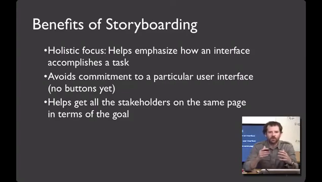
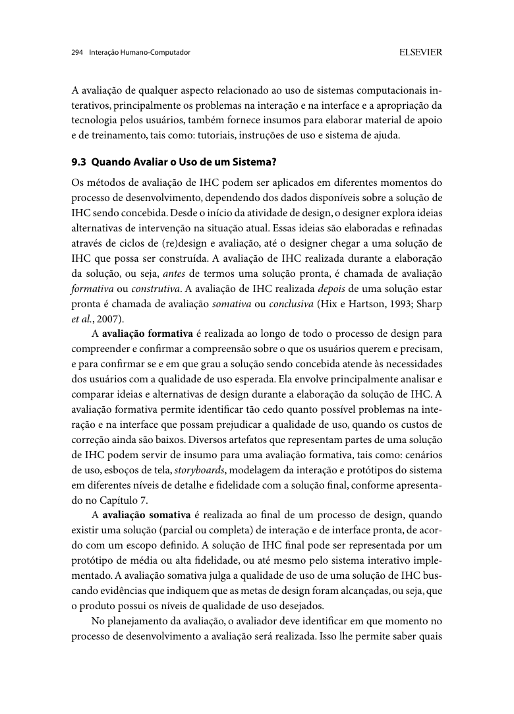
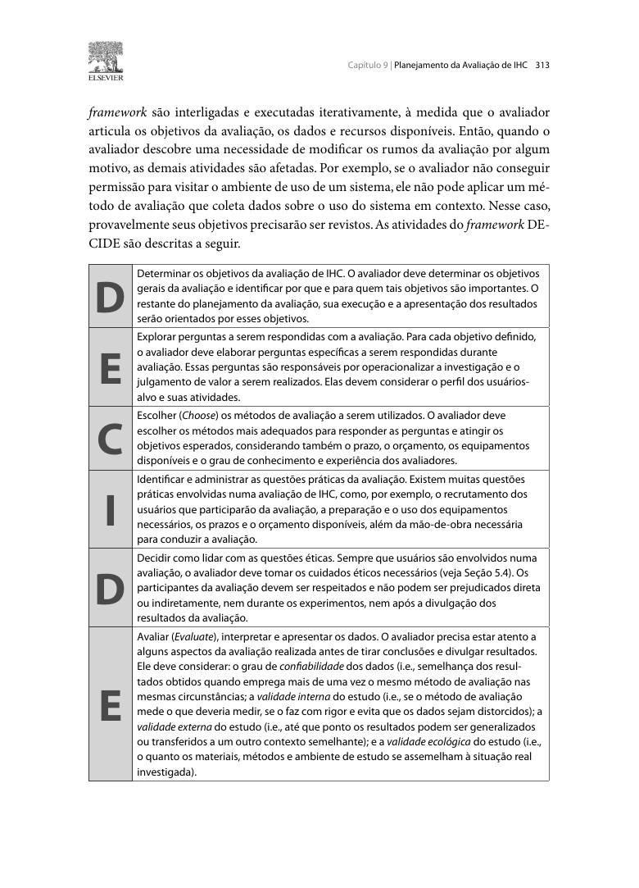
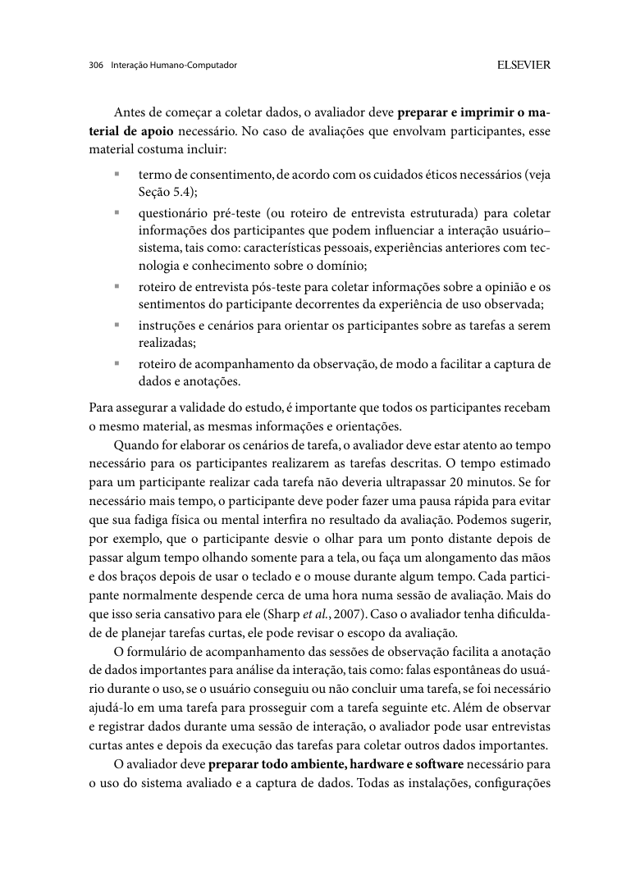
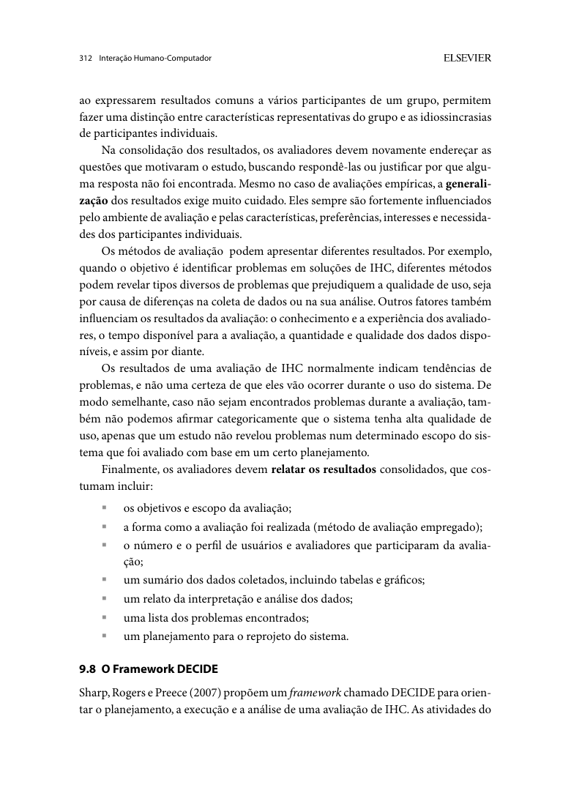

# Documento de Inspeção do Grupo -1 - Grupo 1

**Projeto da Disciplina de Interação Humano-Computador (2026.2)**
Campus Darcy Ribeiro / Faculdade de Ciências da Tecnologia (FCTE) — Turma 01
Prof. Dr. André Barros de Sales — **Grupo 03**

Integrantes do grupo: Alexandre Vilar, Eduardo Ribeiro, Gabriel Robson, Henrique Schneider e João Vitor.

---

## Histórico de Versões

<b>Tabela 1</b> – Histórico de Versões do Documento de Inspeção do Grupo -1.

| Data | Versão | Descrição | Autor(es) | Revisor(es) |
| :---: | :---: | :--- | :--- | :--- |
| 14/10/2026 | 1.0 | Criação da lista: itens do Plano de Ensino (Entrega 4) e 5 itens adicionais com fundamentação. | Henrique Schneider | Todos os integrantes do grupo |
| 14/10/2026 | 1.1 | Figuras com legenda numerada logo abaixo de cada fonte; seção de Agradecimentos com registro de ferramentas e uso de IA generativa por etapa. | Henrique Schneider | Todos os integrantes do grupo |
| 14/10/2026 | 1.2 | Inclusão dos itens adicionais N6 e N7 e dos autores dos itens adicionais; preenchimento das respostas, evidências (minutos da gravação da inspeção e links) e versão, data e hora da avaliação. | Gabriel Robson | Todos os integrantes do grupo |

<b>Fonte</b>: Elaborado pelos autores (2026).

---

## Contexto

Esta lista guia a inspeção por vídeo da Entrega 4 do Grupo -1 (Grupo 1), prevista no cronograma para 14/10/2026. A Entrega 4 cobre o Planejamento da Avaliação do Storyboard e da Análise de Tarefas e o planejamento do relato dos resultados de ambas (Plano de Ensino FIHC 02/2026, Cronograma, aulas 15 e 19).

**Como usar:** para cada item, marque **Sim**, **Não** ou **Incompleto**, anote o minuto do vídeo ou a página do GitHub Pages onde o item aparece e registre versão, data e hora da avaliação. As subseções 1.1 e 1.2 reproduzem a lista sugerida no Plano de Ensino; a seção 2 traz 7 itens novos elaborados pelo grupo inspetor, com a referência de cada um.

Os minutos indicados na coluna **Evidência** referem-se à gravação da reunião de inspeção realizada em 14/10/2026, das 22:38 às 23:08 (ver a [ata da reunião](../../../atas.md#reuniao-02-14102026-inspecao-da-entrega-4-do-grupo-1-grupo-1)); a coluna **Versão, data e hora** indica a versão do GitHub Pages do Grupo 01 avaliada (último commit publicado, de 13/10/2026) e o horário em que cada item começou a ser avaliado.

---

## 1. Lista de verificação do Plano de Ensino

Os itens abaixo reproduzem a lista sugerida para a apresentação 4 no Plano de Ensino FIHC 02/2026 (Turma 01, v1), pp. 8–9 e 12–13. Para a Entrega 4, o plano pede "Todos os 10 itens" do desenvolvimento do projeto, mas a lista de referência (Entrega 1, pp. 8–9) tem 11; todos foram mantidos.

### 1.1 Itens do desenvolvimento do projeto

Avaliar: o próprio grupo e o Grupo -1 (Grupo 1).
URL GitHub Pages Grupo 1: <https://interacao-humano-computador.github.io/2026.2-Grupo01/>

<b>Tabela 2</b> – Itens do desenvolvimento do projeto.

| # | Questão — O GitHub Pages possui: | Resposta (Sim / Não / Incompleto) | Evidência (minuto do vídeo ou link) | Versão, data e hora da avaliação |
| :---: | :--- | :---: | :--- | :--- |
| **D1** | O histórico de versão padronizado? | **Sim** | Vídeo 00:55–02:30; [Planejamento da Avaliação do Storyboard](https://interacao-humano-computador.github.io/2026.2-Grupo01/planejamento/storyboard/planejamento_avaliacao_storyboard/); [Avaliação Formativa (DECIDE)](https://interacao-humano-computador.github.io/2026.2-Grupo01/planejamento/planejamento_avaliacao_decide/) | Commit `f167098` – 14/10/2026, 22:39 |
| **D2** | O(s) autor(es) e o(s) revisor(es) para cada artefato? | **Sim** | Vídeo 02:32–03:15; [Planejamento da Avaliação do Storyboard](https://interacao-humano-computador.github.io/2026.2-Grupo01/planejamento/storyboard/planejamento_avaliacao_storyboard/) (tabela de contribuição) | Commit `f167098` – 14/10/2026, 22:41 |
| **D3** | Referências bibliográficas e/ou bibliografia em todos os artefatos? | **Sim** | Vídeo 03:15–03:35; [Planejamento da Avaliação do Storyboard](https://interacao-humano-computador.github.io/2026.2-Grupo01/planejamento/storyboard/planejamento_avaliacao_storyboard/), seção 11 | Commit `f167098` – 14/10/2026, 22:42 |
| **D4** | As tabelas e imagens possuem legenda e fonte e são chamadas dentro do texto? | **Incompleto** | Vídeo 03:35–04:35; [Planejamento da Avaliação do Storyboard](https://interacao-humano-computador.github.io/2026.2-Grupo01/planejamento/storyboard/planejamento_avaliacao_storyboard/), Tabelas 1 a 3 | Commit `f167098` – 14/10/2026, 22:42 |
| **D5** | Um texto fazendo uma introdução dos artefatos? | **Sim** | Vídeo 04:35–04:57; [Planejamento da Avaliação do Storyboard](https://interacao-humano-computador.github.io/2026.2-Grupo01/planejamento/storyboard/planejamento_avaliacao_storyboard/), seção 1 | Commit `f167098` – 14/10/2026, 22:43 |
| **D6** | O cronograma executado com quem realizou cada artefato/atividade e com as datas de início e fim da construção/realização do artefato/atividade? | **Incompleto** | Vídeo 04:57–05:51; [Cronograma Executado](https://interacao-humano-computador.github.io/2026.2-Grupo01/planejamento/cronograma/cronograma_executado/) | Commit `f167098` – 14/10/2026, 22:43 |
| **D7** | Ata(s) da(s) reuniões (com data, horário de início e do final, participantes, objetivo, atividades definidas etc.)? | **Sim** | Vídeo 05:51–06:15; [Atas e Apresentações](https://interacao-humano-computador.github.io/2026.2-Grupo01/atas/reunioes/) | Commit `f167098` – 14/10/2026, 22:44 |
| **D8** | A gravação da reunião do grupo? | **Sim** | Vídeo 06:15–06:39; [Atas e Apresentações](https://interacao-humano-computador.github.io/2026.2-Grupo01/atas/reunioes/) | Commit `f167098` – 14/10/2026, 22:45 |
| **D9** | Vídeo de apresentação na categoria "não listado" no YouTube? | **Sim** | Vídeo 06:39–07:05; [Atas e Apresentações](https://interacao-humano-computador.github.io/2026.2-Grupo01/atas/reunioes/), seção 2 | Commit `f167098` – 14/10/2026, 22:45 |
| **D10** | Tabela de contribuição no início do artefato com o nome de todos os integrantes com a contribuição de cada integrante com hiperligação da atividade e da gravação, se houver? | **Sim** | Vídeo 07:05–07:50; [Planejamento da Avaliação do Storyboard](https://interacao-humano-computador.github.io/2026.2-Grupo01/planejamento/storyboard/planejamento_avaliacao_storyboard/) (tabela de contribuição) | Commit `f167098` – 14/10/2026, 22:45 |
| **D11** | A seção de agradecimentos apresentando o uso de Inteligência Artificial (IA) Generativa no artefato? | **Sim** | Vídeo 07:50–09:05; [Ferramentas](https://interacao-humano-computador.github.io/2026.2-Grupo01/planejamento/ferramentas/) | Commit `f167098` – 14/10/2026, 22:46 |

<b>Fonte</b>: Adaptado do Plano de Ensino FIHC 02/2026 (Turma 01, v1), pp. 8–9.

### 1.2 Itens do conteúdo da disciplina

Avaliar: o próprio grupo e o Grupo -1 (Grupo 1). A numeração segue o Plano de Ensino, que começa no item 2 desta entrega.

<b>Tabela 3</b> – Itens do conteúdo da disciplina.

| # | Questão — O GitHub Pages possui: | Resposta (Sim / Não / Incompleto) | Evidência (minuto do vídeo ou link) | Versão, data e hora da avaliação |
| :---: | :--- | :---: | :--- | :--- |
| **C2** | O planejamento da avaliação segue o Framework DECIDE? | **Sim** | Vídeo 09:05–09:50; [Planejamento da Avaliação do Storyboard](https://interacao-humano-computador.github.io/2026.2-Grupo01/planejamento/storyboard/planejamento_avaliacao_storyboard/), seção 2 | Commit `f167098` – 14/10/2026, 22:47 |
| **C3** | Descreve o(s) objetivo(s) da avaliação? (apropriação de tecnologia pelos usuários; ideias e alternativas de design; conformidade com um padrão; e/ou problemas na interação e na interface na fase do modelo conceitual) | **Sim** | Vídeo 09:50–11:00; [Planejamento da Avaliação do Storyboard](https://interacao-humano-computador.github.io/2026.2-Grupo01/planejamento/storyboard/planejamento_avaliacao_storyboard/), seção 3 | Commit `f167098` – 14/10/2026, 22:48 |
| **C4** | Os métodos de avaliação a serem utilizados? *Adicionar referência bibliográfica da fonte e foto do texto da referência explicando os métodos de avaliação. Autor:* | **Sim** | Vídeo 11:00–11:20; [Planejamento da Avaliação do Storyboard](https://interacao-humano-computador.github.io/2026.2-Grupo01/planejamento/storyboard/planejamento_avaliacao_storyboard/), seção 5 | Commit `f167098` – 14/10/2026, 22:49 |
| **C5** | As questões práticas da avaliação (recrutamento dos usuários que participarão da avaliação — onde e o perfil; quantos usuários participarão e a razão dessa quantidade; presencial real ou remota; preparação e uso dos equipamentos necessários; prazos; orçamento; recursos de mão de obra necessários para conduzir a avaliação)? | **Sim** | Vídeo 11:20–11:58; [Planejamento da Avaliação do Storyboard](https://interacao-humano-computador.github.io/2026.2-Grupo01/planejamento/storyboard/planejamento_avaliacao_storyboard/), seção 6 | Commit `f167098` – 14/10/2026, 22:50 |
| **C6** | As questões éticas (se os participantes da avaliação devem ser respeitados e não podem ser prejudicados direta ou indiretamente, nem durante os experimentos, nem após a divulgação dos resultados da avaliação)? | **Sim** | Vídeo 11:58–12:54; [Planejamento da Avaliação do Storyboard](https://interacao-humano-computador.github.io/2026.2-Grupo01/planejamento/storyboard/planejamento_avaliacao_storyboard/), seção 8; [Planejamento do Relato do Storyboard](https://interacao-humano-computador.github.io/2026.2-Grupo01/planejamento/storyboard/planejamento_relato_resultados_storyboard/), seção 3.6 | Commit `f167098` – 14/10/2026, 22:50 |
| **C7** | A estrutura do relatório do resultado da avaliação (os objetivos da avaliação; uma breve descrição do método de prototipação em papel; o número e o perfil de avaliadores e dos participantes; as tarefas executadas pelos participantes; lista de problemas encontrados etc.)? | **Sim** | Vídeo 12:54–14:35; [Planejamento do Relato do Storyboard](https://interacao-humano-computador.github.io/2026.2-Grupo01/planejamento/storyboard/planejamento_relato_resultados_storyboard/), seção 3 | Commit `f167098` – 14/10/2026, 22:51 |
| **C8** | Um cronograma (data e horário) e local para realização da avaliação do Storyboard e da Análise das Tarefas? | **Incompleto** | Vídeo 14:35–15:50; [Planejamento da Avaliação do Storyboard](https://interacao-humano-computador.github.io/2026.2-Grupo01/planejamento/storyboard/planejamento_avaliacao_storyboard/), seção 6.4 | Commit `f167098` – 14/10/2026, 22:53 |
| **C9** | Cada desenho do Storyboard está relacionado a uma especificação do artefato da Análise de Tarefas? | **Não** | Vídeo 15:50–16:32; [Planejamento da Avaliação do Storyboard](https://interacao-humano-computador.github.io/2026.2-Grupo01/planejamento/storyboard/planejamento_avaliacao_storyboard/) | Commit `f167098` – 14/10/2026, 22:54 |
| **C10** | A quantidade de storyboards é igual à quantidade de integrantes do grupo? | **Incompleto** | Vídeo 16:32–17:58; [Planejamento da Avaliação do Storyboard](https://interacao-humano-computador.github.io/2026.2-Grupo01/planejamento/storyboard/planejamento_avaliacao_storyboard/), seção 6.4 | Commit `f167098` – 14/10/2026, 22:55 |
| **C11** | A definição do teste piloto e data para realização do teste piloto antes da avaliação? *Adicionar referência bibliográfica da fonte e foto do texto da referência explicando o teste piloto. Autor:* | **Sim** | Vídeo 17:58–18:35; [Planejamento da Avaliação do Storyboard](https://interacao-humano-computador.github.io/2026.2-Grupo01/planejamento/storyboard/planejamento_avaliacao_storyboard/), seção 10 | Commit `f167098` – 14/10/2026, 22:56 |
| **C12** | O resultado do teste piloto não será apresentado no resultado da avaliação? | **Não** | Vídeo 18:35–19:05; [Planejamento da Avaliação do Storyboard](https://interacao-humano-computador.github.io/2026.2-Grupo01/planejamento/storyboard/planejamento_avaliacao_storyboard/), seção 10 | Commit `f167098` – 14/10/2026, 22:57 |
| **C13** | Os itens que o avaliador deve realizar/anotar durante a avaliação (listar os problemas encontrados, priorizar a correção dos problemas não resolvidos)? | **Sim** | Vídeo 19:05–19:40; [Planejamento do Relato do Storyboard](https://interacao-humano-computador.github.io/2026.2-Grupo01/planejamento/storyboard/planejamento_relato_resultados_storyboard/), seção 3.4 | Commit `f167098` – 14/10/2026, 22:57 |

<b>Fonte</b>: Adaptado do Plano de Ensino FIHC 02/2026 (Turma 01, v1), pp. 12–13.

> **Importante** (Plano de Ensino, p. 13): "Cada integrante da equipe deve elaborar ao menos um 1 item de conteúdo da disciplina com referência bibliográfica da fonte e foto do texto da referência."

---

## 2. Itens adicionais do grupo inspetor (7 itens)

Os 7 itens abaixo complementam a lista oficial com critérios adicionais. Cobrem o Planejamento da Avaliação do Storyboard, a Análise de Tarefas e o Relato de Resultados.

* Autor dos itens N1 a N3: Henrique Schneider.
* Autor do item N4: Alexandre Vilar.
* Autor do item N5: João Vitor.
* Autor dos itens N6 e N7: Gabriel Robson.

<b>Tabela 4</b> – Itens adicionais do grupo inspetor.

| # | Questão — O GitHub Pages possui: | Fonte | Resposta (Sim / Não / Incompleto) | Evidência (minuto do vídeo ou link) | Versão, data e hora da avaliação | Autor do Item |
| :---: | :--- | :--- | :---: | :--- | :--- | :--- |
| **N1** | Cada storyboard a ser avaliado comunica os três elementos esperados: **Cenário** (pessoas envolvidas, ambiente, tarefa realizada), **Sequência** (passos, o que leva a pessoa a usar o sistema, tarefa ilustrada) e **Satisfação** (motivação, o que o sistema permite realizar, necessidade atendida)? | Klemmer, vídeo "storyboards.mp4", slide "Storyboards Should Convey", 4:00–5:05 | **Não** | Vídeo 19:40–21:20; [Planejamento do Relato do Storyboard](https://interacao-humano-computador.github.io/2026.2-Grupo01/planejamento/storyboard/planejamento_relato_resultados_storyboard/) | Commit `f167098` – 14/10/2026, 22:58 | Henrique Schneider |
| **N2** | O planejamento classifica a avaliação do Storyboard e da Análise de Tarefas como **formativa** e justifica o momento do processo de design em que ela ocorre? | Barbosa e Silva (2010), cap. 9, seç. 9.3, p. 294, 2º e 4º parágrafos | **Sim** | Vídeo 21:20–22:00; [Avaliação Formativa (DECIDE)](https://interacao-humano-computador.github.io/2026.2-Grupo01/planejamento/planejamento_avaliacao_decide/), seções 1 e 2 | Commit `f167098` – 14/10/2026, 23:00 | Henrique Schneider |
| **N3** | Para cada objetivo da avaliação, há **perguntas específicas** a serem respondidas (etapa "E – Explorar perguntas" do DECIDE), considerando o perfil dos usuários-alvo e suas atividades? | Barbosa e Silva (2010), cap. 9, seç. 9.8, p. 313, atividade "E" | **Sim** | Vídeo 22:00–22:52; [Planejamento da Avaliação do Storyboard](https://interacao-humano-computador.github.io/2026.2-Grupo01/planejamento/storyboard/planejamento_avaliacao_storyboard/), seção 4 | Commit `f167098` – 14/10/2026, 23:00 | Henrique Schneider |
| **N4** | O planejamento lista o **material de apoio** da sessão (termo de consentimento, questionário pré-teste, roteiro de entrevista pós-teste, instruções e cenários de tarefa derivados da Análise de Tarefas, roteiro de acompanhamento da observação) e estima até 20 min por tarefa? | Barbosa e Silva (2010), cap. 9, seç. 9.7.2, p. 306, 1º e 2º parágrafos | **Sim** | Vídeo 22:52–25:10; [Avaliação Formativa (DECIDE)](https://interacao-humano-computador.github.io/2026.2-Grupo01/planejamento/planejamento_avaliacao_decide/), seção 6.3 | Commit `f167098` – 14/10/2026, 23:01 | Alexandre Vilar |
| **N5** | O planejamento do relato descreve como os resultados serão **consolidados** (análise intersujeito, buscando recorrências entre participantes) e prevê no relatório o sumário dos dados com tabelas e gráficos, a interpretação dos dados e um **planejamento para o reprojeto**? | Barbosa e Silva (2010), cap. 9, seç. 9.7.5, pp. 311–312, 1º parágrafo e último parágrafo | **Sim** | Vídeo 25:10–25:55; [Planejamento do Relato do Storyboard](https://interacao-humano-computador.github.io/2026.2-Grupo01/planejamento/storyboard/planejamento_relato_resultados_storyboard/), seções 3.8 e 3.9 | Commit `f167098` – 14/10/2026, 23:04 | João Vitor |
| **N6** | O planejamento define como os avaliadores deverão agir caso um participante não consiga concluir uma tarefa, incluindo quando oferecer ajuda, quando interromper a atividade e como registrar essa dificuldade sem influenciar o resultado da avaliação? | Barbosa e Silva (2010), cap. 9, seção 9.7.2, p. 306 (referência relacionada; confirmar fundamentação específica e incluir foto). | **Não** | Vídeo 25:55–27:34; [Planejamento da Avaliação do Storyboard](https://interacao-humano-computador.github.io/2026.2-Grupo01/planejamento/storyboard/planejamento_avaliacao_storyboard/), seção 7.1 | Commit `f167098` – 14/10/2026, 23:04 | Gabriel Robson |
| **N7** | O planejamento estabelece como os problemas de usabilidade identificados na avaliação serão classificados por gravidade, considerando seu impacto na realização das tarefas, para orientar quais problemas deverão ser corrigidos primeiro? | Barbosa e Silva (2010), cap. 9, seção 9.7.5, pp. 311–312 (referência relacionada; confirmar classificação por gravidade e incluir foto). | **Sim** | Vídeo 27:34–28:41; [Planejamento do Relato do Storyboard](https://interacao-humano-computador.github.io/2026.2-Grupo01/planejamento/storyboard/planejamento_relato_resultados_storyboard/), seção 3.4 | Commit `f167098` – 14/10/2026, 23:06 | Gabriel Robson |

<b>Fonte</b>: Elaborado por Henrique Schneider, Alexandre Vilar, João Vitor e Gabriel Robson (2026), com base em Klemmer e Barbosa e Silva (2010).

### 2.1 Fundamentação dos itens adicionais

**N1 — Elementos de um storyboard.** O slide "Storyboards Should Convey" (vídeo "storyboards.mp4", Scott Klemmer, hci-class.org, aprox. 4:00–5:05) lista: "Setting – People involved, Environment, Task being accomplished"; "Sequence – What steps are involved? What leads someone to use the app? What task is being illustrated?"; "Satisfaction – What motivates people to use this system? What does it enable people to accomplish? What need does the system fill?". Logo depois (aprox. 5:10), o slide "Benefits of Storyboarding" afirma que o storyboard "Helps get all the stakeholders on the same page in terms of the goal".

<i><b>Figura 1</b> — Slide "Storyboards Should Convey", que lista o que um storyboard deve comunicar: Setting (cenário), Sequence (sequência) e Satisfaction (satisfação). Fonte: Klemmer, vídeo "storyboards.mp4", 4:50.</i>

<i><b>Figura 2</b> — Slide "Benefits of Storyboarding", com os benefícios do storyboard, entre eles alinhar todos os interessados quanto ao objetivo. Fonte: Klemmer, vídeo "storyboards.mp4", 5:15.</i>

**N2 — Avaliação formativa.** "Diversos artefatos que representam partes de uma solução de IHC podem servir de insumo para uma avaliação formativa, tais como: cenários de uso, esboços de tela, storyboards, modelagem da interação e protótipos do sistema […]" (Barbosa e Silva, 2010, cap. 9, seç. 9.3, p. 294, 2º parágrafo). "No planejamento da avaliação, o avaliador deve identificar em que momento no processo de desenvolvimento a avaliação será realizada." (idem, 4º parágrafo).

<i><b>Figura 3</b> — Seção 9.3, que define avaliação formativa e cita storyboards como insumo dela. Fonte: Barbosa e Silva (2010), cap. 9, p. 294.</i>

**N3 — Perguntas por objetivo (DECIDE).** "Para cada objetivo definido, o avaliador deve elaborar perguntas específicas a serem respondidas durante [a] avaliação. Essas perguntas são responsáveis por operacionalizar a investigação e o julgamento de valor a serem realizados. Elas devem considerar o perfil dos usuários-alvo e suas atividades." (Barbosa e Silva, 2010, cap. 9, seç. 9.8, p. 313, atividade "E").

<i><b>Figura 4</b> — Atividades do framework DECIDE, com destaque para a atividade "E – Explorar perguntas". Fonte: Barbosa e Silva (2010), cap. 9, seç. 9.8, p. 313.</i>

**N4 — Material de apoio e duração das tarefas.** O material "costuma incluir: termo de consentimento […]; questionário pré-teste (ou roteiro de entrevista estruturada) […]; roteiro de entrevista pós-teste […]; instruções e cenários para orientar os participantes sobre as tarefas a serem realizadas; roteiro de acompanhamento da observação […]" (Barbosa e Silva, 2010, cap. 9, seç. 9.7.2, p. 306, 1º parágrafo). "O tempo estimado para um participante realizar cada tarefa não deveria ultrapassar 20 minutos." (idem, 2º parágrafo).

<i><b>Figura 5</b> — Lista do material de apoio de uma avaliação com participantes e limite de 20 minutos por tarefa. Fonte: Barbosa e Silva (2010), cap. 9, seç. 9.7.2, p. 306.</i>

**N5 — Consolidação e relato.** "[…] os resultados individuais são consolidados e analisados em conjunto, em uma análise denominada de intersujeito ou interparticipante […]. Nessa atividade, os avaliadores buscam recorrências nos resultados de acordo com o método selecionado." (Barbosa e Silva, 2010, cap. 9, seç. 9.7.5, p. 311, 1º parágrafo). Os resultados consolidados "costumam incluir: […] um sumário dos dados coletados, incluindo tabelas e gráficos; um relato da interpretação e análise dos dados; uma lista dos problemas encontrados; um planejamento para o reprojeto do sistema." (idem, p. 312, último parágrafo).

<i><b>Figura 6</b> — Início da seção 9.7.5, que descreve a análise intersujeito na consolidação dos resultados. Fonte: Barbosa e Silva (2010), cap. 9, p. 311.</i>

<i><b>Figura 7</b> — Itens que o relato dos resultados consolidados costuma incluir, terminando no planejamento para o reprojeto. Fonte: Barbosa e Silva (2010), cap. 9, p. 312.</i>

---

## Agradecimentos

Agradecemos ao Prof. Dr. André Barros de Sales, docente da disciplina Interação Humano Computador (FGA0173, UnB – Faculdade do Gama, 02/2026), pela orientação do projeto e pela lista de verificação do Plano de Ensino que serviu de base para este documento.

### Registro de ferramentas utilizadas

<b>Tabela 5</b> – Registro de ferramentas utilizadas.

| Ferramenta | Tipo | Uso no projeto |
| :--- | :--- | :--- |
| Claude (Anthropic) | IA generativa | Apoio na montagem deste documento: transcrição da lista, localização de citações e redação dos itens adicionais |
| Gemini (Google) | IA generativa | Apoio à pesquisa e revisão de textos do projeto |
| Google Docs | Editor de documentos | Versão compartilhada da lista de verificação e registro da inspeção |
| Visual Studio Code | Editor de código | Edição dos arquivos do GitHub Pages do grupo |
| GitHub Pages | Hospedagem | Publicação dos artefatos do projeto inspecionados |

<b>Fonte</b>: Elaborado pelos autores (2026).

### Uso de Inteligência Artificial Generativa

A IA generativa foi usada exclusivamente como auxílio, conforme o Código de Conduta da SBC citado no Plano de Ensino (p. 3). Todo o conteúdo foi conferido pelo autor, que permanece responsável por ele.

<b>Tabela 6</b> – Uso de IA generativa por etapa.

| Etapa | Ferramenta de IA | Auxílio prestado | Verificação humana |
| :--- | :--- | :--- | :--- |
| 1. Transcrição da lista do Plano de Ensino | Claude | Extração do texto dos itens da Entrega 4 (pp. 8–9 e 12–13) | Conferência dos itens com o PDF do plano |
| 2. Levantamento do conteúdo do vídeo | Claude | Marcação dos minutos | Conferência dos minutos no vídeo |
| 3. Localização das citações no livro | Claude | Busca das passagens no cap. 9 e indicação de página, seção e parágrafo | Conferência das citações com as figuras |
| 4. Auxílio na redação dos itens adicionais (Localização de Fontes e sugestões de materiais de consulta) (N1–N5) | Claude | Proposta de materiais para consulta, com o objetivo de fornecer inspiração para redação dos itens adicionais | Redação, revisão e aprovação dos itens |
| 5. Formatação do documento e das figuras | Claude | Organização das tabelas, figuras e legendas | Revisão final do documento |

<b>Fonte</b>: Elaborado pelos autores (2026).

---

## Referências

* BARBOSA, Simone Diniz Junqueira; SILVA, Bruno Santana da. *Interação Humano-Computador*. 1. ed. Rio de Janeiro: Elsevier/Campus, 2010. Cap. 9 – Planejamento da Avaliação de IHC, pp. 285–318. Arquivo consultado: "INTERACAO_HUMANO_COMPUTADOR.pdf" (página do livro = página do PDF − 5). Versão gratuita: [leanpub.com/ihc-ux](https://leanpub.com/ihc-ux).
* KLEMMER, Scott. *Storyboards, Paper Prototypes, and Mock-ups*. Videoaula, hci-class.org. Arquivo consultado: "storyboards.mp4" (5:53).
* UNIVERSIDADE DE BRASÍLIA. *Plano de Ensino – Interação Humano Computador (FGA0173)*, Turma 01, 02/2026, v1. Prof. Dr. André Barros de Sales. Lista de Verificação, pp. 8–9 e 12–13; Cronograma, aulas 15 e 19.
